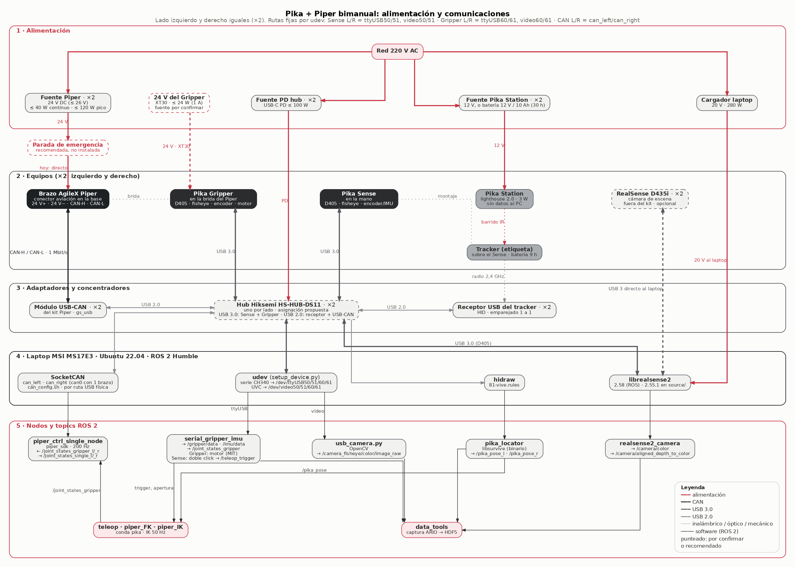
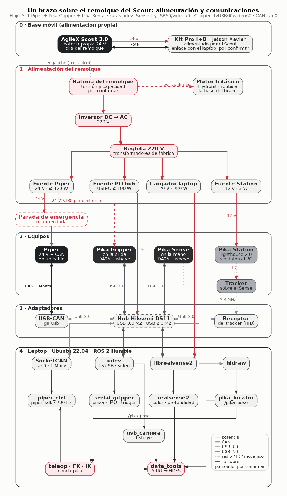

# Arquitectura de alimentación y comunicaciones

Cómo se conectan los equipos del sistema bimanual (Flujo A+: 2 Pika Sense, 2 Pika Gripper,
2 brazos Piper y 2 Pika Station). Cubre desde la red eléctrica hasta los topics de ROS 2: fuentes,
CAN, USB, receptores del tracker, cámaras y drivers. Estado al 20 de octubre de 2026.



Versión vectorial: [arquitectura_comunicaciones.svg](arquitectura_comunicaciones.svg). La fuente
editable es [arquitectura_comunicaciones.dot](arquitectura_comunicaciones.dot) (Graphviz). Cada
bloque tiene posición fija en una grilla, con una columna por cadena (CAN, Gripper, Sense, tracker,
cámaras), y las flechas son ortogonales (con codos). Para regenerar las imágenes:

```bash
python3 ~/pika_ros/docs/arquitectura/generar_diagrama.py   # necesita Graphviz y Pillow
```

El script dibuja en dos pasadas y las superpone: las franjas de fondo por un lado, y los bloques y
las flechas por otro. Hace falta porque el enrutado ortogonal de Graphviz trata cualquier nodo como
obstáculo. Para mover un bloque, cambiar su `pos="x,y!"` (en puntos); la grilla está documentada
al comienzo del `.dot`. Las etiquetas de las flechas van en `xlabel`.

Las líneas y bordes punteados marcan lo que está **por confirmar** o **recomendado y no instalado**.

### Versión de un brazo, sobre el remolque del Scout



[SVG](arquitectura_un_brazo.svg) · fuente [arquitectura_un_brazo.dot](arquitectura_un_brazo.dot). Para
regenerarla: `python3 generar_diagrama.py arquitectura_un_brazo.dot`.

Montaje del Flujo A: un Piper con Pika Gripper, Pika Sense y Pika Station, sobre un remolque que
tira un **AgileX Scout 2.0**. Está dibujada angosta (~780 pt): al ancho de una página de 16 cm, los
títulos quedan en ~8 pt y los detalles en ~7 pt.

Alimentación:
- **Scout 2.0:** se alimenta con su propia batería de 24 V, junto con el **kit Pro I+D** (Jetson Xavier). No alimenta nada del remolque.
- **Remolque:** su batería alimenta dos cosas:
  - el **motor trifásico** que reubica la base del brazo;
  - un **inversor DC → AC de 220 V**, conectado a una regleta donde todos los equipos se enchufan con sus transformadores de fábrica (Piper, Station, laptop, hub).

Por confirmar:
- la tensión y capacidad de la batería del remolque, y cómo se acciona el motor;
- **el tipo de motor:** el presupuesto CSV describe el Hydronit MA6C1ST08 como un motor de 12 V DC, pero en el montaje se describe como trifásico;
- si hay enlace de datos entre la Jetson del Scout y el laptop;
- la fuente de 24 V del Pika Gripper (ver la sección 4).

## 1. Alimentación

| Equipo | Entrada | Consumo | Fuente del dato |
|---|---|---|---|
| Brazo Piper (×2) | 24 V DC (24–26 V) por el conector aviación de la base, desde su adaptador | ≤ 40 W continuo, ≤ 120 W pico | manual del Piper |
| Pika Gripper, motor (×2) | 24 V DC por XT30(PB) | ≤ 24 W (firmware limita a 1 A); ~2–7 W sujetando | hoja de datos Pika + `sensor_tools` |
| Pika Sense / Gripper, sensores | 5 V por el mismo cable USB Type-C de datos | ~4–5 W por unidad (estimado) | [Consumo_Energia.md](../energia/Consumo_Energia.md) |
| Tracker (×2) | batería propia, 9 h; recarga por su puerto | ~0,5 W (estimado) | hoja de datos Pika |
| Pika Station (×2) | 12 V por adaptador, o batería 12 V / 10 Ah (30 h) | 3 W | hoja de datos Pika |
| Hub Hiksemi DS11 (×2) | USB-C PD propia (≤ 100 W), no desde el laptop | electrónica ~2–5 W + lo que entrega | [Equipo_actualizado.docx](../energia/Equipo_actualizado.docx) |
| Laptop MSI MS17E3 | cargador 20 V / 280 W | según carga | etiqueta del cargador |

Presupuesto completo por configuración: [docs/energia](../energia/Consumo_Energia.md).

## 2. Enlaces de comunicación

| Enlace | Medio y protocolo | Driver / ruta en el sistema | Nodo ROS 2 → topics |
|---|---|---|---|
| Piper ↔ PC | CAN-H/CAN-L del conector aviación → módulo USB-CAN incluido con el brazo; CAN a 1 Mbit/s | `gs_usb` → SocketCAN `can_left` / `can_right` (`can_config.sh`, por ruta USB física); un brazo: `can0` | `piper_ctrl_single_node` (`piper_sdk`): recibe `/joint_states_gripper_*`, publica `/joint_states_single_*` a 200 Hz |
| Pika Sense / Gripper ↔ PC | **un solo** cable USB 3.0 Type-C por unidad, con tres dispositivos detrás | ver las tres filas siguientes | — |
| · cámara de profundidad D405 | USB 3 (UVC + controles RealSense); 87° × 58°, 7–50 cm, hasta 90 FPS | `librealsense2` 2.58 (ROS), fuente 2.55.1 en `source/` | `realsense2_camera` → `/camera/color/...`, `/camera/aligned_depth_to_color/...` |
| · cámara fisheye (~200°) | UVC | udev → `/dev/video50/51` (Sense), `/dev/video60/61` (Gripper) | `usb_camera.py` → `/camera_fisheye/color/image_raw` |
| · encoder / IMU / motor | serie USB (CH340) | udev → `/dev/ttyUSB50/51` (Sense), `/dev/ttyUSB60/61` (Gripper) | `serial_gripper_imu` → `/gripper/data`, `/imu/data`, `/joint_states_gripper`; en el Sense, el doble click llama a `/teleop_trigger`; en el Gripper, manda el motor |
| Tracker ↔ PC | radio 2,4 GHz → receptor USB emparejado 1 a 1 | HID: `hidraw` (`81-vive.rules`) | `pika_locator` (libsurvive, binario) → `/pika_pose_l`, `/pika_pose_r` |
| Pika Station → tracker | barrido infrarrojo (lighthouse 2.0); **sin datos hacia el PC** | — (canal configurado en la estación) | — |
| D435i de escena (×2, opcional) | USB 3, directo al laptop | `librealsense2` | `realsense2_camera` (otro namespace) |

Las rutas fijas (`/dev/ttyUSB5x`/`6x`, `/dev/video5x`/`6x`) las crean las reglas udev que genera
`scripts/setup_device.py`. **Cada unidad debe quedar siempre en el mismo puerto USB**, porque las
reglas dependen de él, igual que la ruta USB física que usa `can_config.sh`.

## 3. Topología USB propuesta

Cada unidad Pika usa un solo cable USB 3.0, así que su D405, su fisheye y su puerto serie van
siempre juntos. Con dos hubs Hiksemi HS-HUB-DS11 (2 × USB 3.0 + 2 × USB 2.0 cada uno), la
asignación natural es **un hub por lado**:

| Puerto | Hub izquierdo | Hub derecho |
|---|---|---|
| USB 3.0 #1 | Pika Sense L | Pika Sense R |
| USB 3.0 #2 | Pika Gripper L | Pika Gripper R |
| USB 2.0 #1 | receptor del tracker L | receptor del tracker R |
| USB 2.0 #2 | USB-CAN `can_left` | USB-CAN `can_right` |

- **Ancho de banda:** cada hub lleva dos D405 por un mismo enlace USB 3.0 de 5 Gbit/s hacia el laptop. A 640 × 480 a 30 FPS (lo que usan los `start_*.bash`) sobra margen; a resoluciones máximas habría que revisarlo.
- **D435i de escena:** van a puertos USB 3 propios del laptop.
- **Después de cablear:** correr `setup_device.py` y actualizar las rutas USB de `can_config.sh` (`lsusb -t`).

## 4. Qué está verificado y qué no

**Verificado en la documentación oficial o en el código de este repo:**
- **Piper:** cable con 24 V y CAN-H/CAN-L hacia el módulo USB-CAN incluido (manual del Piper); CAN a 1 Mbit/s (`can_config.sh`).
- **Sense y Gripper:** cada uno con un cable USB 3.0 Type-C; el CAN del conector del Gripper está "reservado, sin uso"; el motor va a 24 V por XT30 (hoja de datos Pika).
- **Rutas de dispositivo, nodos y topics:** reglas udev de `setup_device.py`, launch files de `sensor_tools` y `pika_remote_piper`.
- **Pika Station:** 12 V y 3 W, sin cable de datos al PC.

**Por confirmar en el montaje:**
1. **De dónde sale el 24 V del Pika Gripper.** El presupuesto CSV dice que del bus de 24 V del Piper, por XT30. El manual del Piper, en cambio, solo lista "Power Interface ×1, CAN Interface ×1" en la base y no menciona una salida de potencia en la brida. El kit Pika trae un cable XT30 de 0,35 m.
2. **La asignación de puertos de los hubs** (sección 3). El inventario `.docx` propone un hub "dedicado a las dos D405" y otro para fisheye/serie/CAN, pero eso **no es posible**: la D405, la fisheye y el puerto serie de cada unidad Pika salen por el mismo cable.
3. **Parada de emergencia:** recomendada en el inventario, en la línea de 24 V de los brazos; hoy no existe.
4. **Cantidad de D435i:** el `.docx` dice 2 cámaras de escena, aparte del kit Pika. El CSV `presupuesto_energetico_equipos.csv` cuenta 4 "una por unidad Pika", confundiéndolas con las D405 que traen el Sense y el Gripper.
