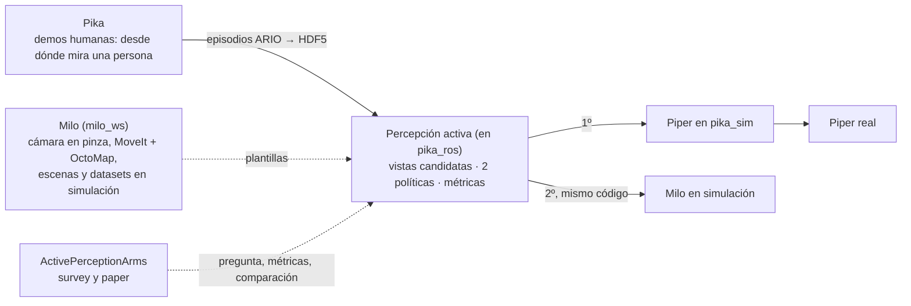

# Percepción activa: Pika + Piper, Milo y ActivePerceptionArms

Este documento junta lo que conecta tres repositorios. Sirve para retomar el trabajo desde
cualquiera de ellos, o desde otra máquina, sin depender de notas locales. Estado al
**19 de octubre de 2026**.

## 1. Los tres repositorios

| Repositorio | Rama de trabajo | Qué contiene | Rol en la investigación |
|---|---|---|---|
| [**Ivan1721/pika_ros**](https://github.com/Ivan1721/pika_ros/tree/pika-custom-ros2) (este) | `pika-custom-ros2` | ROS 2 Humble para el kit Pika (Sense + Gripper + Vive) y el brazo Piper; simulación `pika_sim` | **Aquí vive el código de percepción activa.** Primer robot: Piper |
| [**Ivan1721/milo_ws**](https://github.com/Ivan1721/milo_ws/tree/brazo) | `brazo` | Milo (`andesrobot`), manipulador móvil del equipo: base, lift, brazo EB300 de 6 GDL, cámara en la pinza; Docker `milo:humble` | **Punto intermedio:** plantillas ya resueltas y segundo robot (sección 2) |
| [**Ivan1721/ActivePerceptionArms**](https://github.com/Ivan1721/ActivePerceptionArms) (privado) | `main` | Survey sistemático de percepción activa con manipuladores (PRISMA, foco en agricultura) y manuscrito | Pregunta de investigación, estado del arte y paper. **No tiene código** |

## 2. Milo como punto intermedio

La pregunta de investigación es cómo un brazo con la cámara en la pinza elige la vista que mejor
revela una fruta ocluida. Pika + Piper y Milo cubren partes distintas de ese problema:

- **Pika + Piper** tiene lo que falta en los otros dos. Pika registra **demostraciones humanas**
  con la cámara en la mano: D405, fisheye, pose 6-DoF y pinza. Piper es un brazo que **se puede
  validar en real**.
- **Milo** ya resolvió en simulación casi todo lo que el bucle de percepción activa necesita y que
  Piper aún no tiene:
  - cámara de profundidad en la pinza, simulada con los topics del driver real;
  - MoveIt 2 con chequeo de choques y OctoMap desde la nube de puntos;
  - escenas aleatorizadas;
  - datasets YOLO etiquetados automáticamente desde la geometría conocida;
  - en su [repaso de tecnologías, §11](https://github.com/Ivan1721/milo_ws/blob/brazo/docs/tecnologias/README.md#11-alcanza-milo-a-hacer-nbv), un nodo `nbv_planner` ya diseñado.

Milo cumple dos papeles:

1. **Fuente de patrones:** cada paso de la hoja de ruta (sección 6) parte de un archivo de Milo
   que ya funciona.
2. **Segundo robot:** cuando el planner funcione en Piper, se corre sin cambios de código en Milo,
   que tiene otro brazo y otra cámara. Así se muestra que el método no depende del robot.



## 3. Decisiones tomadas

| Fecha | Decisión | Por qué |
|---|---|---|
| 2026-10-19 | Las pruebas físicas se posponen | El robot está en mudanza; el Vive y el Pika Sense no están conectados |
| 2026-10-19 | Simulador: **Gazebo Classic 11** con ROS 2 Humble | Ya funciona en `pika_ros` y en Milo; es lo que usan los trabajos comparables (tabla de abajo). Isaac Sim queda para después: el portátil actual tiene 15 GB de RAM y una RTX 3070 de 8 GB. Jazzy + Harmonic obligaría a migrar a Ubuntu 24.04, y `pika_locator` solo existe como binario para Humble |
| 2026-10-19 | El código de percepción activa va en **`pika_ros`** | ActivePerceptionArms es para el estado del arte; `milo_ws` es un repo de equipo |
| 2026-10-19 | Primer robot: **Piper en `pika_sim`** | Es el único brazo que se puede validar en real (Milo no tiene driver del brazo) |
| 2026-10-19 | Implementar **dos políticas** y compararlas | NBV volumétrico (ganancia de información en un mapa 3D, estilo *active_grasp*) y heurística de visibilidad (YOLO) |

**Simuladores en la bibliografía.** Se revisaron 137 PDFs de ActivePerceptionArms: NBV de fruta,
robots de cosecha, surveys de percepción activa, preprints y simulación. La tabla cuenta los
papers que nombran cada simulador al menos dos veces fuera de las referencias:

| Simulador | Papers | Ejemplos |
|---|---|---|
| Gazebo (+ MoveIt/ROS) | 18 | GS-NBV (palto, D435 en la muñeca, 2025); NBV-SC (2023); Burusa et al. sobre tomate: *attention-driven*, *semantics-aware*, *gradient-based* (2024); *Autonomous Apple Fruitlet Sizing* (2024); GO-VMP (2025); *Receding-Horizon NBV* (2026, Gz Sim + MoveIt 2) |
| Isaac Sim | ~6 | datasets sintéticos fotorrealistas: *One-Shot Multimodal Active Perception* (2026), BRAVE-6D, TAVIS |
| RLBench / robosuite / ManiSkill / MuJoCo | ~9 | aprendizaje de políticas de percepción activa (imitación, *diffusion policy*) |
| Unity / Unreal | ~7 | reviews de gemelos digitales; árboles de Unreal en *Optimising Fruit Harvesting Paths* (2026) |

Para NBV de fruta con brazo, Gazebo es el estándar en los trabajos comparables.

## 4. Estado actual

| Pieza | Estado |
|---|---|
| `pika_sim` fase 1: teleop de Piper + gripper Pika en Gazebo sin hardware | ✅ Probada headless contra los nodos reales de FK/IK/teleop. Uso: [src/pika_sim/README.md](../../src/pika_sim/README.md) y Flujo D+ del [Manual](../manuales/Manual.md) |
| Cámaras simuladas en la pinza Pika | ⏳ paso 1 |
| MoveIt para Piper + Pika | ⏳ paso 2. Existe una config para la pinza original del Piper en `piper_ros` (fuera de este repo) |
| Escena de fruta, planner, experimentos | ⏳ pasos 3–5 |
| Captura teleop con `data_tools` | ⚠️ las configs `*_pika_teleop` esperan topics que este fork no publica; ver [problemas conocidos](../manuales/Manual.md#problemas-conocidos-del-software) |
| Milo: `nbv_planner` | Diseñado en su documentación, no implementado |

## 5. Contrato común por robot

El código de percepción activa no nombra a ningún robot: recibe estos parámetros.

| Parámetro | Piper + Pika (`pika_sim`) | Milo |
|---|---|---|
| Nube de puntos | `/gripper/camera/depth/color/points` (por definir en el paso 1) | `/gripper_camera/depth/points` |
| Frame óptico de la cámara | `pika_depth_link` (D405) | `gripper_camera_depth_optical_frame` |
| Grupo de MoveIt y frames | por definir en el paso 2 (6 ejes, punta `pika_tcp`) | `brazo` (7 ejes: lift + 6), `base_footprint` → `gripper_tcp` |
| Rango útil de la cámara | D405: ~0,07–0,5 m | Gemini Plus: 0,25–2,5 m (mejor 0,3–0,8 m) |
| Radio de las vistas candidatas | ~0,15–0,35 m | 0,4–0,6 m |
| Alcance del brazo | ~0,63 m | ~0,85 m más el lift |
| Mando | MoveIt → `FollowJointTrajectory` (modo `control:=moveit`, paso 2) | MoveIt → `FollowJointTrajectory` |
| Entorno de ejecución | nativo, sin conda (la teleop usa conda `pika`) | Docker `milo:humble` |

Los dos robots se comunican sin configurar nada: ambos usan Humble, el contenedor de Milo usa la red
del host y los dos usan `ROS_DOMAIN_ID` 0. Lo que **no** se puede es correr las dos simulaciones a la
vez, porque las dos usan el puerto 11345 de Gazebo; hay que cambiar `GAZEBO_MASTER_URI` en una.

## 6. Hoja de ruta

| Paso | Qué | Plantilla en Milo |
|---|---|---|
| 1 | D405 (color, profundidad, nube) y fisheye simuladas en la pinza Pika, con **los topics del hardware real**, para que `data_tools` grabe igual que en real | [`andesrobot.gripper_camera.xacro`](https://github.com/Ivan1721/milo_ws/blob/brazo/ros2_ws/src/andesrobot_description/urdf/andesrobot.gripper_camera.xacro): `<remapping>` a los nombres del driver real |
| 2 | Config de MoveIt para Piper + Pika con OctoMap desde la D405, y modo `control:=moveit` en `pika_sim` con `JointTrajectoryController` (la teleop sigue en posición directa) | [`andesrobot_moveit_config`](https://github.com/Ivan1721/milo_ws/tree/brazo/ros2_ws/src/andesrobot_moveit_config): SRDF a mano, `sensors_3d.yaml` |
| 3 | Escena de fruta con hojas y oclusión controlada y aleatorizable. Visibilidad real por trazado de rayos sobre la geometría conocida (esferas y planos), porque Gazebo Classic no trae cámara de segmentación. Etiquetado automático para afinar YOLO, porque la fruta simulada no se parece a la real | [`mesa_prueba.sdf`](https://github.com/Ivan1721/milo_ws/blob/brazo/ros2_ws/src/andesrobot_arm/worlds/mesa_prueba.sdf), [`generar_dataset_manija.py`](https://github.com/Ivan1721/milo_ws/blob/brazo/ros2_ws/src/andesrobot_arm/scripts/generar_dataset_manija.py) |
| 4 | Paquete de percepción activa: vistas candidatas en un casquete, filtro de alcance y choques con MoveIt, **las dos políticas**, criterio de parada y registro en CSV | [`arm_moveit_node.py`](https://github.com/Ivan1721/milo_ws/blob/brazo/ros2_ws/src/andesrobot_arm/andesrobot_arm/arm_moveit_node.py) (pose → MoveGroup, motivos de falla) y el diseño de [`nbv_planner`](https://github.com/Ivan1721/milo_ws/blob/brazo/docs/tecnologias/README.md#cómo-se-implementaría) |
| 5 | Experimentos por nivel de oclusión (visibilidad 25/50/70/75/100 %, los mismos rangos del estudio YOLO de oclusión): visibilidad alcanzada, número de vistas, tiempo y recorrido articular, contra controles fijos (una vista frontal, una órbita fija) | — |
| 6 | Milo como segundo robot (mismos nodos, otros parámetros) y demos humanas con Pika como línea base | todo lo anterior |

Modelos de vegetación, escenas agrícolas, datasets publicados y material del sistema Pika que se
pueden usar para mejorar la escena: [recursos_publicos.md](recursos_publicos.md). Frutas candidatas
(la primera demo es con manzanas) y su encaje con el Piper y la pinza Pika:
[frutas_candidatas.md](frutas_candidatas.md).

Los lazos de control, la cinemática (con la precisión medida de la IK), el lazo de impedancia y
el procedimiento detallado para generar el NBV en Piper + Pika están en
[lazos_cinematica_nbv.md](lazos_cinematica_nbv.md).

## 7. Cómo retomar el trabajo

Desde otra máquina o desde otro repositorio:

```bash
git clone git@github.com:Ivan1721/pika_ros.git ~/pika_ros
cd ~/pika_ros && git checkout pika-custom-ros2
git submodule update --init --recursive
# instalar source/install.zip y dependencias según docs/manuales/Manual.md (§1–8)
colcon build --packages-select data_msgs && source install/setup.bash
colcon build && source install/setup.bash
ros2 launch pika_sim sim_piper_single.launch.py     # comprobar que la simulación arranca
```

Lecturas, en orden:

1. Este documento y [lazos_cinematica_nbv.md](lazos_cinematica_nbv.md).
2. [AGENTS.md](../../AGENTS.md): estructura, entornos Python, sync con upstream, convenciones.
3. [src/pika_sim/README.md](../../src/pika_sim/README.md): contrato de topics del simulador.
4. En Milo: [CLAUDE.md](https://github.com/Ivan1721/milo_ws/blob/brazo/CLAUDE.md) y [docs/tecnologias §11](https://github.com/Ivan1721/milo_ws/blob/brazo/docs/tecnologias/README.md#11-alcanza-milo-a-hacer-nbv).
5. En ActivePerceptionArms: `docs/estado_del_arte/PLAN_SURVEY.md`.
