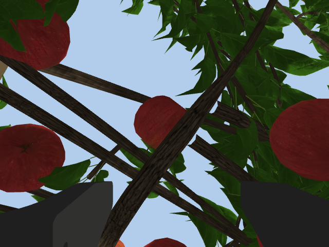
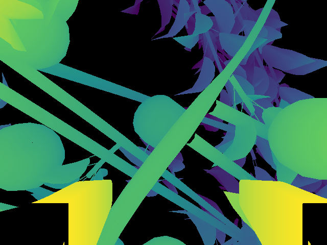
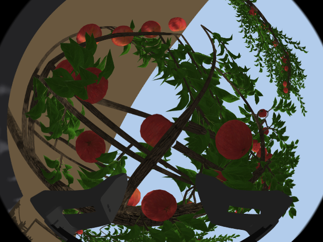
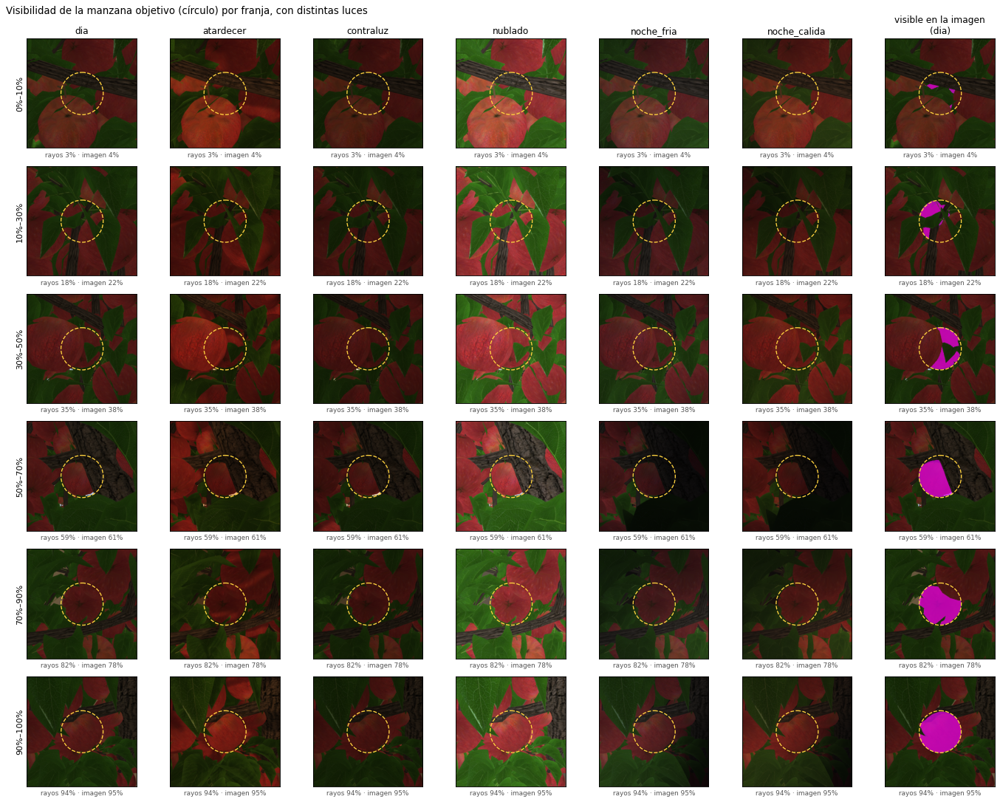
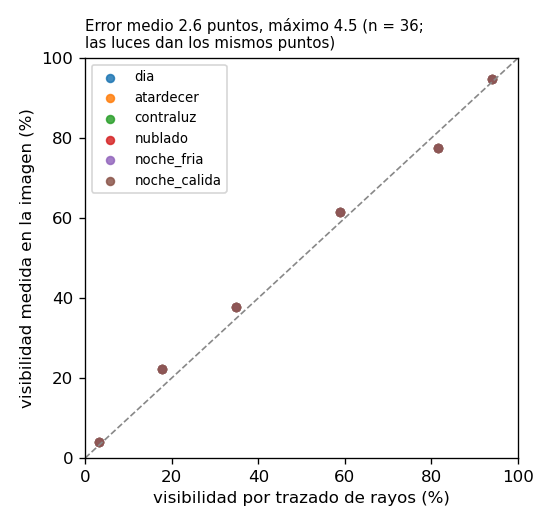

# Escenarios de simulación para percepción activa (Piper + Pika)

Informe del 20 de octubre de 2026. Reúne los escenarios agrícolas de `pika_sim`: el manzano de
primitivas, el muro frutal realista de Helios con tres densidades de fruta y follaje, seis
condiciones de iluminación y una galería de manzanas con distinto nivel de visibilidad. Todos los
números salen de corridas en este repositorio; cómo reproducirlas está en la
[sección 7](#7-cómo-reproducirlo). El método de NBV está en
[lazos_cinematica_nbv.md §5](lazos_cinematica_nbv.md#5-cómo-se-generaría-el-nbv-en-piper--pika), y el
plan general en el [README de percepción activa](README.md).

## Resumen

- **Escena realista.** El manzano de Helios trae tronco, ramas con sus horquetas, hojas con la silueta y la textura de una hoja real, y manzanas con textura. Se puede variar la semilla, la edad y la densidad de fruta y follaje.
- **La visibilidad que calcula el planner coincide con la cámara.** En 36 imágenes, 6 franjas de oclusión con 6 luces, la diferencia entre el trazado de rayos y lo medido en la imagen fue de 2,6 puntos en promedio y 4,5 como máximo ([sección 4](#4-oclusión-manzanas-con-distinto-nivel-de-visibilidad)).
- **En un árbol real, las ramas limitan tanto como el brazo.** Con el muro frutal, entre 5 y 11 de las 20 vistas candidatas meten la cámara o las garras en las ramas. Solo 2 a 4 vistas quedan disponibles.
- **Mirar desde otra vista paga.** De frente, la manzana objetivo se ve entre 0 % y 39 %; desde la mejor vista alcanzable, entre 46 % y 96 %. El caso extremo es la densidad alta: de 7 % a 96 %.
- **La iluminación no cambia la geometría, pero sí la imagen.** Contraluz, atardecer y noche con focos LED son los casos que tendría que resolver el detector.
- **El simulador es liviano, pero para grabar hay que correrlo sin ventanas.** El caso más pesado, con densidad alta, Gazebo y RViz, usa 2,7 de 16 núcleos, 2,2 GB y 78 % de la GPU, y la física va en tiempo real. En ese caso las cámaras bajan de los 25 Hz que exige la captura de datos ([sección 6](#6-consumo-de-recursos)).

## 1. Qué se simula

| Elemento | En la simulación |
|---|---|
| Brazo | Piper con el gripper Pika, en Gazebo Classic 11 |
| Cámaras del gripper | D405 (color, profundidad en 16UC1 mm y nube, 87°) y fisheye (180°), 640 × 480 a 30 Hz, con los topics del hardware (`/gripper/camera/...`) |
| Plataforma | El robot va sobre una plataforma; el suelo del huerto queda a la altura que resulte (0,76–0,83 m en estos escenarios) |
| Árbol | Manzano frente al robot, con la manzana objetivo en (0,55; 0; 0,30) m desde la base del Piper |
| Verdad del terreno | Posición y radio de cada manzana, triángulos de hojas y madera (`/escena/verdad`) |
| Gripper | Modelo oficial de AgileX (mallas y plano de cámaras, recibido el 20-10-2026): la D405 y la fisheye miran a lo largo del eje de la herramienta; apertura 0–94 mm |

**Visibilidad.** Es la fracción del área que la manzana ocupa en la imagen que no queda tapada
por hojas, madera ni otras manzanas. Se calcula trazando rayos desde puntos repartidos sobre el
disco de la manzana hasta la cámara. La [sección 4](#4-oclusión-manzanas-con-distinto-nivel-de-visibilidad)
la valida contra las imágenes de Gazebo.

**Vistas candidatas.** Son 20, en un casquete alrededor de la manzana, del lado del robot. Una
vista es **alcanzable** si cumple tres condiciones:
- la IK de la D405 converge, con error menor a 5 mm y 3°;
- J5 queda lejos de la singularidad de la muñeca (|J5| > 10°);
- con el árbol de Helios, ni la cámara ni las puntas de las garras pasan a menos de 3 cm de tronco o ramas.

## 2. Escenarios

### 2.1 De primitivas a un árbol real

| Manzano de primitivas | Muro frutal de Helios |
|---|---|
|  |  |
| Tronco y ramas como cilindros, 83 hojas como discos, 4 manzanas como esferas | Árbol completo de [Helios](https://github.com/PlantSimulationLab/PyHelios), con un vecino a cada lado de la hilera |

El muro frutal (`apple_fruitingwall`) es el sistema en espaldera de los huertos pensados para
cosecha robótica. Lo genera
[`generar_manzano_helios.py`](../../src/pika_sim/scripts/generar_manzano_helios.py). Cada hoja se
recorta a la silueta de la foto y se escribe con sus dos caras: Gazebo no dibuja la cara trasera
de un triángulo, y sin eso, cerca de la mitad de las hojas desaparecía de la imagen según desde dónde se
mirara. La validación de la sección 4 detectó ese problema.

### 2.2 Densidad de fruta y follaje


| | `base` (la de Helios) | `media` | `alta` |
|---|---|---|---|
| Manzanas por árbol | 39 | 197 | 264 |
| Manzanas raleadas | 0 | 57 | 714 |
| Hojas por árbol | 1318 | 2307 | 4366 |
| Manzanas en la hilera (3 árboles) | 117 | 591 | 792 |

La densidad cambia cinco parámetros de los brotes de Helios: brotación floral, cuaja, manzanas por
dardo, brotación vegetativa y tamaño de hoja. Helios deja las manzanas de un mismo dardo casi en el
mismo punto. El generador las separa sin moverlas más de 6 cm, les agrega un pedúnculo y ralea las
que no caben, como en un huerto real.

### 2.3 Iluminación


| `luz` | Sol | Caso |
|---|---|---|
| `dia` | blanco, alto, con sombras | referencia |
| `atardecer` | cálido (~3000 K), bajo y de frente | hora dorada: color anaranjado y sombras largas |
| `contraluz` | cálido, detrás del árbol | la cara que ve el robot queda en sombra |
| `nublado` | frío (~7000 K) y difuso, sin sombras | día nublado |
| `noche_fria` | casi nulo; tres focos LED fríos (~6500 K) en la plataforma | cosecha nocturna |
| `noche_calida` | casi nulo; tres focos LED cálidos (~3000 K) | cosecha nocturna |

## 3. NBV en cada escenario

| Escenario | Casquete | Alcanzables | Chocan con ramas | Visibilidad de frente | Mejor vista alcanzable |
|---|---|---|---|---|---|
| Primitivas | 0,22 m | 7 de 20 | — | 0 % | 47 % (elev. 35°, azim. −25°) |
| Helios base | 0,30 m | 4 de 20 | 8 | 39 % | 69 % (elev. −15°, azim. 0°) |
| Helios media | 0,30 m | 3 de 20 | 5 | 12 % | 46 % (elev. 10°, azim. −25°) |
| Helios alta | 0,30 m | 2 de 20 | 11 | 7 % | 96 % (elev. 10°, azim. 25°) |

- **Cada escenario tiene su propia manzana objetivo.** El nodo de la escena elige la que de frente se ve cerca de un 30 %, así que la tabla no es una comparación controlada.
- **La luz no cambia estos números.** Las seis iluminaciones dan exactamente los mismos resultados, porque la visibilidad es geométrica. Lo que cambia es la imagen.
- **Casquete de 0,30 m con Helios.** Las garras de la Pika llegan unos 15 cm por delante de la D405. Con 0,22 m quedan a ~3 cm de la manzana, entre las ramas: en la primera prueba con Helios, 18 de 20 vistas chocaban. Con 0,30 m quedan a ~10 cm, y la D405 sigue en su mejor rango (15–35 cm).
- **Con densidad alta, la vista de frente ve un 7 % y una vista lateral alcanzable, un 96 %.** Es el caso que justifica el NBV: la manzana está expuesta, pero no desde donde mira el robot.

Lo que ven las cámaras del gripper con el brazo en la mejor vista del árbol base:

| D405 color | D405 profundidad (amarillo cerca, morado lejos) | Fisheye |
|---|---|---|
|  |  |  |

## 4. Oclusión: manzanas con distinto nivel de visibilidad



Cada fila es una franja de visibilidad, de casi oculta a casi completa. Cada columna es una
iluminación, con la misma manzana y la misma vista. El círculo marca la manzana objetivo. La última
columna muestra en magenta la parte de la manzana que se ve en la imagen, que es lo que mide la
validación.

**Cómo se arma** ([`galeria_oclusion.py`](../../src/pika_sim/scripts/galeria_oclusion.py)):
1. Se toman las 53 manzanas del muro de densidad media que quedan al alcance del Piper y sobre la cubierta de la plataforma.
2. Para cada una se evalúan 15 vistas en el casquete de 0,30 m: 795 pares manzana–vista. Se elige uno por franja.
3. Cada ejemplo se fotografía con una cámara virtual con el campo visual de la D405.
4. **Validación:** se pone una esfera magenta emisiva sobre la manzana, 6 % más grande, y se vuelve a fotografiar. Los píxeles que cambian son la parte visible. La fracción visible en la imagen es esa área sobre el disco proyectado.

| Franja | Visibilidad por rayos | Visibilidad en la imagen | Qué la tapa |
|---|---|---|---|
| 0–10 % | 3 % | 4 % | una rama y hojas |
| 10–30 % | 18 % | 22 % | hojas |
| 30–50 % | 35 % | 38 % | otra manzana delante y hojas |
| 50–70 % | 59 % | 61 % | el tronco |
| 70–90 % | 82 % | 78 % | hojas en el borde |
| 90–100 % | 94 % | 95 % | casi nada |



- **Diferencia media de 2,6 puntos y máxima de 4,5** entre rayos e imagen, en las 36 fotos. La medición en la imagen es la misma con las seis luces, porque la esfera emisiva no depende de la iluminación.
- **Dos correcciones salieron de esta validación:**
  - La visibilidad se calculaba antes con puntos repartidos sobre la superficie de la manzana. Así, el borde, que en la imagen casi no se ve, pesaba igual que el centro: en un ejemplo daba 45 % contra 60 % en la imagen. Ahora los puntos se reparten sobre el disco que la manzana ocupa en la imagen.
  - Gazebo no dibujaba la cara trasera de las hojas, así que la imagen veía detrás de hojas que el cálculo sí contaba. Ahora las hojas tienen las dos caras.
- **Para el detector:** la misma manzana al 35 % se ve muy distinta de día, a contraluz o de noche. La galería sirve de base para medir cómo cae la detección por franja y por luz, como el estudio YOLO de oclusión (25–100 %), y para generar datos etiquetados automáticamente.

## 5. Lo que falta para un estudio controlado

- **Barrer la oclusión con la misma manzana.** Fijar la manzana y la vista, y variar la densidad o la semilla. Es el paso 5 de la hoja de ruta.
- **Choques del brazo completo:** hoy solo se revisan la cámara y las garras. Hace falta MoveIt.
- **La plataforma no está en el modelo de rayos.** La galería solo usa manzanas sobre la cubierta. Las de más abajo quedan tapadas por la plataforma en la imagen, y el cálculo no lo sabe.
- **Fruta real:** reemplazar la malla de manzana de Helios por una de las [100 manzanas escaneadas](https://zenodo.org/records/15635995) ([recursos_publicos.md §1b](recursos_publicos.md#1b-árboles-completos-hojas-ramas-y-frutos-en-3d-revisión-del-20-10-2026-segunda-parte)).

## 6. Consumo de recursos

Medido en el equipo de desarrollo: Ryzen 7 5800H (8 núcleos, 16 hilos), 15 GB de RAM y RTX 3070
Laptop. La CPU va en núcleos.

| Configuración | CPU | RAM | GPU | Cámaras (D405 / fisheye) |
|---|---|---|---|---|
| Helios base, sin ventanas | 1,3 núcleos | 0,9 GB | 39 % | 30 / 30 Hz |
| Helios alta, sin ventanas | 1,3 núcleos | 1,1 GB | 40 % | 30 / 30 Hz |
| Helios base, con Gazebo y RViz | 2,5 núcleos | 1,7 GB | 50 % | 30 / 30 Hz |
| Helios alta, con Gazebo y RViz | 2,7 núcleos | 2,2 GB | 78 % | **24 / 17–23 Hz** |
| Helios base, sin las cámaras del gripper | 0,4 núcleos | 0,6 GB | 0 % | — |

Las cámaras del gripper son lo que más cuesta, no el árbol. Con ventanas, RViz gasta más que
Gazebo, sobre todo por la nube de puntos de la D405. **Para grabar con `data_tools` hay que correr
sin ventanas:** con densidad alta y ventanas, las cámaras bajan de los 25 Hz que exige la captura. Detalle de las nueve configuraciones medidas:
[src/pika_sim/README.md](../../src/pika_sim/README.md#consumo-de-recursos).

## 7. Cómo reproducirlo

```bash
# una vez: los árboles de Helios (entorno virtual aparte, sin ROS)
python3 -m venv ~/.venvs/helios && ~/.venvs/helios/bin/pip install pyhelios3d pillow
for d in base media alta; do
  env -u PYTHONPATH ~/.venvs/helios/bin/python -I ~/pika_ros/src/pika_sim/scripts/generar_manzano_helios.py --densidad $d
done

# un escenario (sin conda; DISPLAY hace falta para las cámaras de Gazebo)
ros2 launch pika_sim sim_piper_single.launch.py escena:=manzano arbol:=helios densidad:=media luz:=atardecer
ros2 run pika_sim escena_nbv_demo.py --salida <carpeta>                       # sección 3
ros2 run pika_sim galeria_oclusion.py capturar --salida <carpeta>             # sección 4

# figuras
python3 ~/pika_ros/src/pika_sim/scripts/galeria_oclusion.py panel <salida.png> --mascara <carpeta_dia>:dia <carpeta_atardecer>:atardecer ...
python3 ~/pika_ros/src/pika_sim/scripts/galeria_oclusion.py validacion <salida.png> <carpeta_dia>:dia ...
python3 ~/pika_ros/src/pika_sim/scripts/panel_variantes.py <salida.png> <título> <carpeta>:<rótulo> ...
```

Todos los argumentos del launch están en [src/pika_sim/README.md](../../src/pika_sim/README.md).
