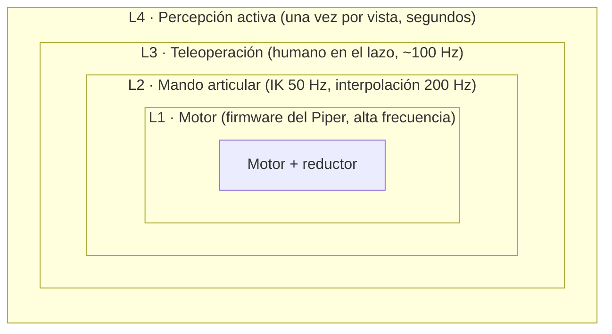
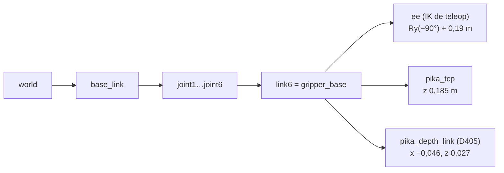
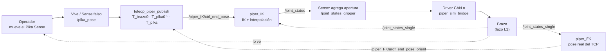
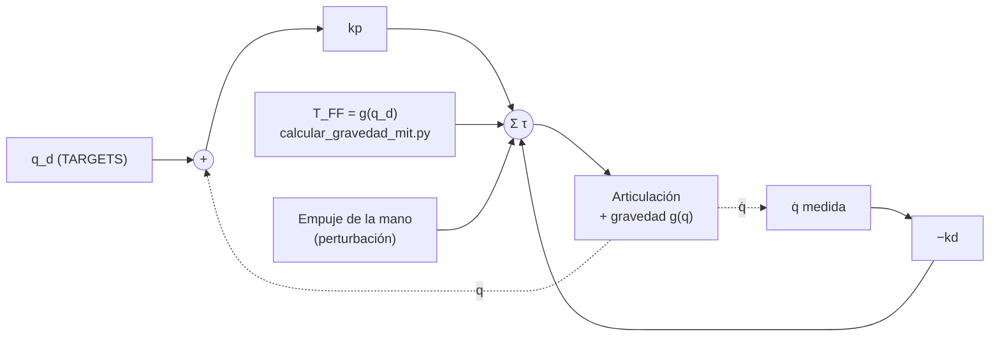
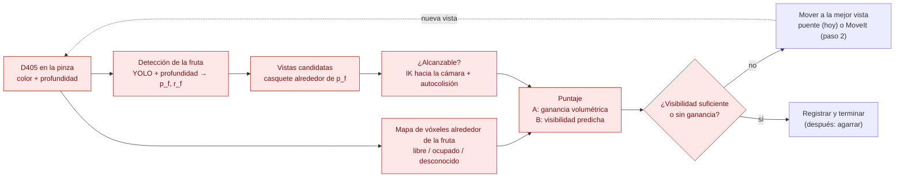
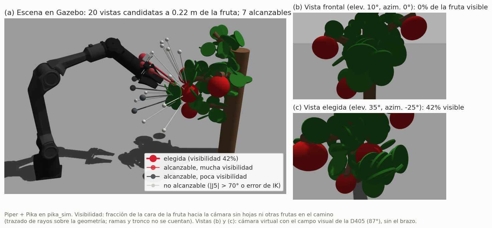
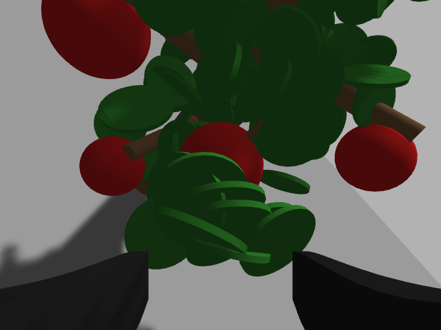
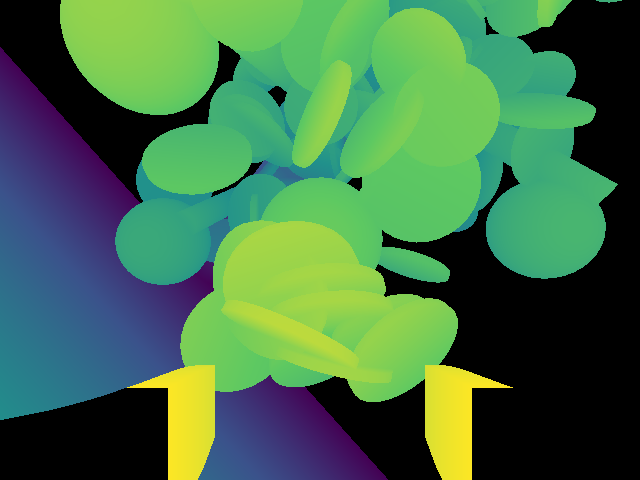
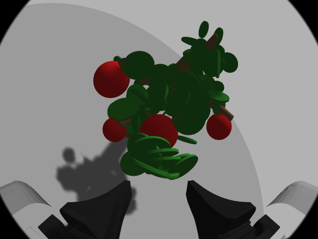

# Lazos de control, cinemática, impedancia y generación de NBV (Piper + Pika)

Revisión técnica del 20 de octubre de 2026. Describe cómo funciona hoy cada lazo del sistema, con
datos medidos en este repositorio, y cómo se generaría el *next-best-view* (NBV) sobre esa base.
Complementa al [plan de percepción activa](README.md).

En los diagramas, las flechas punteadas son retroalimentación (la medición que vuelve) y los
bloques en rojo son los que todavía no existen.

## 1. Panorama: lazos anidados

Cada lazo trabaja con lo que le entrega el de adentro. Si un lazo interno falla, los de afuera
operan con datos falsos.

| Lazo | Quién lo cierra | Tasa | Medida en este repo |
|---|---|---|---|
| L1 motor | firmware del Piper: posición, o MIT (`kp`, `kd`, `t_ref`) | interna, no documentada | — |
| L2 mando | `piper_IK.py` → driver CAN | IK por cada pose recibida; publicación 50 Hz; saltos > 30° interpolados en pasos de 1° a 200 Hz | IK en caliente 2,7 ms (mediana) |
| L2 feedback | driver → `/joint_states_single` | 200 Hz | 199,8 Hz en `pika_sim` |
| L3 teleop | operador mirando el brazo | pose del Sense: Vive real; 100 Hz con el Sense falso | — |
| L4 NBV | planner de vistas (por construir) | 1 decisión cada varios segundos | IK en frío 6,8 ms → ~50 candidatos < 0,5 s |

## 2. Cinemática

### Modelo

- **Brazo:** URDF de `piper_description` (`src/PikaAnyArm/piper/piper_ros/src/piper_description`), con 6 articulaciones rotacionales. Las garras (`joint7`, `joint8`) quedan bloqueadas en el modelo que usan FK e IK (`buildReducedRobot`).
- **Límites [rad]:**

  | | J1 | J2 | J3 | J4 | J5 | J6 |
  |---|---|---|---|---|---|---|
  | mín | −2,618 | 0 | −2,967 | −1,745 | −1,22 | −2,094 |
  | máx | 2,168 | 3,14 | 0 | 1,745 | 1,22 | 2,094 |

  J2 y J3 tienen su cero en un tope: es la pose plegada.
- **Herramienta:** la IK de la teleop agrega un frame `ee` a `joint6`: una rotación de −90° en Y y luego `gripper_xyzrpy` = 0,19 m (`piper_rand_params.yaml`), es decir, 0,19 m a lo largo del eje Z de `link6`.
- **Pinza Pika** (`pika_description`, frames medidos desde `gripper_base`, montado en `link6`):

  | Frame | Posición | Notas |
  |---|---|---|
  | `pika_depth_link` | (−0,046, 0, 0,027) m | D405 |
  | `pika_fisheye_link` | (−0,0735, 0, 0,037) m | fisheye |
  | `pika_tcp` | (0, 0, 0,185) m | **5 mm antes** que el `ee` de la IK (0,19 m); hay que unificarlo |

Medidas, rangos de cada articulación, alcance y figuras del modelo: [pika_description/docs/PIPER_PIKA.md](../../src/pika_description/docs/PIPER_PIKA.md). Ahí también se verifica que la muñeca es esférica en la práctica y que J5 = 0 es una singularidad (J4 ∥ J6).

### FK e IK

- **FK:** pinocchio sobre el modelo reducido (`Arm_FK.get_pose`).
- **IK** (`Arm_IK.ik_fun` en `arm_FIK.py`): optimización con CasADi + IPOPT.

  minimizar `20·(‖e_p‖² + 0,01·‖e_o‖²) + 0,01·‖q‖²`, sujeto a `q_min ≤ q ≤ q_max`

  - `e_p` es el error de posición y `e_o` el de orientación, ambos de `log6(T_ee⁻¹ · T_objetivo)`. El peso de orientación es 0,1 al cuadrado.
  - Arranca desde la solución anterior. Si la nueva difiere más de 30°, la siguiente vuelve a arrancar desde cero.
  - IPOPT con 50 iteraciones y `tol` 1e-4.
  - Revisa autocolisiones con la geometría de pinocchio y descarta la solución si choca.
  - Calcula `tau_ff = rnea(q, 0, 0)`, la gravedad, pero la teleop no la usa.

**Medido** con 40 objetivos alcanzables (generados por FK desde posturas aleatorias), arrancando en frío:

| Variante | Error de posición (mediana / p90) | Error de orientación (mediana / p90) | Tiempo |
|---|---|---|---|
| Actual (regularización 0,01‖q‖²) | 9,4 / 16,7 mm | 8,5° / 15,9° | 6,8 ms mediana, 19,8 ms máx |
| Sin regularización | 0,0 / 2,7 mm | 0,0° / 7,4° | similar |
| Actual con 200 iteraciones | igual que con 50 | igual | — |

El error viene de la **regularización hacia `q = 0`**, no del límite de iteraciones. En la teleop
es razonable: evita posturas raras y el operador corrige mirando. **Para el NBV no sirve**: 8,5°
de error apuntando la cámara son ~3,7 cm de desvío a 25 cm de la fruta. El NBV debe usar
`‖q − q_actual‖²`, que además es su costo de movimiento, y verificar la pose lograda con FK
(sección 5.4). El p90 sin regularización (7,4°) son mínimos locales por arrancar desde cero:
se corrigen arrancando desde `q_actual` o con varios arranques.

## 3. Lazo de teleoperación (Flujo A y D+)

- **Movimiento relativo:** al iniciar (doble click del Sense), se guardan la pose del Sense y la del brazo. Desde ahí, el desplazamiento de la mano se aplica **en el marco de la herramienta**. Verificado en `pika_sim`: un arrastre de 5 cm movió el TCP 4,8 cm en la dirección rotada que predice la orientación de la herramienta.
- **Quién cierra el lazo:** la IK no corrige errores acumulados; el lazo externo lo cierra el operador mirando el brazo. Por eso la imprecisión de la IK es tolerable en la teleop.
- **Pose vieja:** si la pose tiene más de 1 s, `piper_IK` deja de mandar comandos.

## 4. Lazo de impedancia (modo MIT)

Cada motor aplica, dentro del firmware:

`τ = kp·(q_d − q) + kd·(0 − q̇) + t_ref`, con `t_ref = ESCALA_GRAVEDAD · g(q_d)`

- **Por qué la compensación:** sin `t_ref`, J2/J3 caen a sus topes, la pose plegada. Verificado en Gazebo: −14,6° / +40,5°, igual que lo predicho.
- **Estabilidad:** con `t_ref` constante, la gravedad suma una rigidez `∂g/∂q` que en esta pose llega a **−5,2 N·m/rad** en J2. La pose es estable solo si `kp·I + ∂g/∂q` es definida positiva:
  - con `kp` = 5 hay un autovalor de −1,68: inestable, y en Gazebo el brazo se escapó a J2 ≈ +95°;
  - con J2 = 20 y J3 = 15 es estable: cede [4,0°, 0,7°] por cada N·m de empuje en J2, en Gazebo y en el cálculo.
- **Alternativa no implementada:** `t_ref = g(q)` recalculado en vivo, que elimina la rigidez negativa y permite un `kp` arbitrariamente bajo. Requiere un bucle rápido que lea las articulaciones; el script actual reenvía a 1 Hz, como el demo del SDK.
- **Herramientas:** `scripts/calcular_gravedad_mit.py` (T_FF y estabilidad) y `pika_sim control:=mit` (emulación). Uso en el [Manual, B.3](../manuales/Manual.md#b3--prueba-de-impedancia-modo-mit).

**Relación con la percepción activa:** en modo impedancia, la cámara de la pinza cede si roza una
hoja en vez de empujarla. Es un modo de ejecución candidato para acercarse a la planta, después de
que el NBV funcione en modo posición.

## 5. Cómo se generaría el NBV en Piper + Pika

### 5.1 Entradas

- **Fruta objetivo:** máscara YOLO en la imagen de color, retroproyectada con la profundidad, da los puntos de la fruta, su centro `p_f` y su radio aparente `r_f`. Si la fruta está muy ocluida, la estimación es pobre; el propio NBV la va refinando vista a vista.
- **Mapa:** grilla de vóxeles en un cubo de ~0,3 m alrededor de `p_f` (resolución ~5 mm), integrando cada nube de la D405 con la pose de la cámara por FK. Puede ser OctoMap (lo que usa MoveIt) o un TSDF de Open3D. Los vóxeles de la fruta forman la **región de interés**.

### 5.2 Vistas candidatas

Posiciones de la cámara sobre un casquete esférico centrado en la fruta:

`c = p_f + r · (cos θ cos φ, cos θ sin φ, sin θ)`

| Parámetro | Valores iniciales | Por qué |
|---|---|---|
| Radio `r` | 0,15 / 0,22 / 0,30 m | la D405 mide bien entre ~7 y 50 cm; a 15–30 cm la fruta llena una parte útil de la imagen |
| Elevación `θ` | −30° a +60°, cada 15° | desde abajo hasta por arriba de la fruta |
| Azimut `φ` | ±70° alrededor de la dirección base → fruta, cada 20° | el brazo no rodea la planta por detrás |

Son ~150 candidatos. Con la IK a ~7 ms, filtrarlos cuesta ~1 s; se puede reducir con un
filtro barato de distancia al hombro antes de la IK.

**Orientación (*look-at*):** el eje óptico (Z de la cámara) apunta de `c` a `p_f`. El eje X de la
imagen se elige perpendicular a la vertical del mundo, para que la imagen no rote; si las
posturas lo exigen, el giro alrededor del eje óptico queda libre y lo elige la IK.

### 5.3 Alcanzabilidad

1. Resolver la IK **directamente para el frame óptico de la D405**, agregado al modelo de pinocchio desde el URDF de `pika_description`. Así no hace falta pasar de la pose de la cámara a la del TCP, ni depender del `ee` de 0,19 m.
2. Usar el costo `‖q − q_actual‖²` en vez de `‖q‖²`, arrancando desde `q_actual`.
3. Aceptar la vista si:
   - el error lograda/pedida es < 5 mm y < 3° (verificado con FK);
   - no hay autocolisión (`check_self_collision`);
   - hay margen a los límites articulares;
   - está lejos de la singularidad de muñeca, con |J5| > ~10° (con J5 = 0, J4 y J6 quedan alineados; ver [PIPER_PIKA.md](../../src/pika_description/docs/PIPER_PIKA.md));
   - después del paso 2, no hay choque con el mapa: `MoveIt` con OctoMap.

### 5.4 Puntaje: las dos políticas

| | **A · NBV volumétrico** | **B · Heurística de visibilidad** |
|---|---|---|
| Idea | mirar donde más se aprende del espacio desconocido de la fruta | mirar desde donde más fruta se vería |
| Cálculo | rayos desde `c` dentro del campo visual de la D405, submuestreados (p. ej. 32 × 24); se recorre la grilla hasta el primer vóxel ocupado y se cuentan los **vóxeles desconocidos de la región de interés** atravesados (ganancia; variantes de [Isler et al. 2016] con entropía) | puntos sobre la esfera estimada de la fruta (`p_f`, `r_f`) que miran hacia `c`; fracción cuyo rayo hasta `c` no cruza vóxeles ocupados (hojas) = **visibilidad predicha** `V̂` |
| Puntaje | `ganancia − λ · ‖q_v − q_actual‖_W` | `V̂ − λ · ‖q_v − q_actual‖_W` |
| Referencia | Connolly 1985; Isler 2016; Breyer 2022 (*active_grasp*) | enlaza con el estudio YOLO por nivel de visibilidad (25–100 %) |

`‖·‖_W` es la distancia articular ponderada: las articulaciones grandes (J1–J3) pesan más, porque
mueven más masa y tardan más.

### 5.5 Parada y ejecución

- **Parar** cuando se cumpla una de estas condiciones:
  - la visibilidad **medida** (YOLO tras moverse) supera un umbral: 70 % para empezar, el nivel en que el estudio de oclusión vio caer la calidad;
  - la mejor ganancia es < ε;
  - se alcanza un máximo de 6 vistas.
- **Mover**, en orden de disponibilidad:
  1. **Ya posible en `pika_sim`:** mandar la solución de la IK por el contrato del puente (`/joint_states_gripper`), interpolada. Sin chequeo de choques con la planta, así que solo en simulación.
  2. **Después del paso 2:** MoveIt con OctoMap, que planifica sin chocar.
  3. **Opcional:** acercamiento final en modo impedancia (sección 4).

### 5.6 Ejemplo en simulación: manzano

Demo con **manzanas**, el primer cultivo elegido para probar
(`ros2 launch pika_sim sim_piper_single.launch.py escena:=manzano` y luego
`ros2 run pika_sim escena_nbv_demo.py`, datos en
[img/nbv_manzano_escena.json](img/nbv_manzano_escena.json)):
- **El manzano:** un tronco, cinco ramas, 83 hojas al azar con semilla fija (la escena es reproducible) y cuatro manzanas de ~7,5 cm.
- **La manzana objetivo** cuelga detrás de un racimo de hojas.
- **Las candidatas:** 20 vistas en un casquete de 0,22 m.
- **La visibilidad** se calcula trazando rayos contra las hojas y las otras manzanas; las ramas y el tronco todavía no se cuentan.
- **La alcanzabilidad,** con IK para la D405: error < 5 mm y < 3°, y |J5| > 10°.

Resultados:
- **La vista frontal ve el 0 % de la manzana objetivo,** aunque se ven las otras: un detector encontraría frutas, pero no la que se busca.
- **La mejor vista alcanzable** (elevación 35°, azimut −25°) la ve en un 42 %.
- **Solo 7 de las 20 vistas son alcanzables,** igual que en la escena de prueba. Las vistas laterales (±50°), las altas (60°) y las que miran hacia arriba exigen girar la muñeca más allá de su límite de ±70°: en el Piper, la cinemática restringe tanto como la oclusión.
- Supuesto: la D405 mira a lo largo del eje de la herramienta. Las vistas (b) y (c) son cámaras virtuales con su campo visual, sin el brazo.

Con la simulación lanzada con `escena:=manzano`, la demo también guarda lo que ven las cámaras
simuladas del gripper con el brazo en la mejor vista. Son los mismos topics que publica el
hardware ([src/pika_sim/README.md](../../src/pika_sim/README.md#cámaras-del-gripper)):

| D405 color | D405 profundidad (amarillo cerca, morado lejos; negro fuera de 7–50 cm) | Fisheye |
|---|---|---|
|  |  |  |

La manzana objetivo queda al centro de la D405, tapada en parte por el racimo, y abajo se ven las
garras de la pinza. El 70 % de los píxeles tiene profundidad dentro del rango de la D405, con
mediana de 0,20 m. Es coherente con el casquete de 0,22 m, medido desde la fruta.

La primera escena de prueba, con una fruta y tres hojas en disco (`--escena prueba`), dio 0 % de
frente y 50 % en la mejor vista: [img/nbv_escena_panel.png](img/nbv_escena_panel.png).

### 5.7 Medición

- **Visibilidad real:** en simulación se calcula por **trazado de rayos sobre la geometría conocida** (esferas de fruta, discos de hoja), porque Gazebo Classic no tiene cámara de segmentación. Se compara con `V̂` (lo que el planner creía) y con YOLO (lo que el detector vio).
- **Registro por vista** (CSV): `q`, pose de la cámara, ganancia, `V̂`, visibilidad YOLO, visibilidad real, tiempo y distancia articular.
- **Comparación:** las dos políticas y dos controles fijos (una vista frontal y una órbita fija), por nivel de oclusión.

## 6. Qué falta, en orden

| # | Qué | Para qué lazo |
|---|---|---|
| 1 | D405 + fisheye simuladas con el frame óptico definido ([hoja de ruta, paso 1](README.md#6-hoja-de-ruta)) | L4 |
| 2 | Unificar el TCP: `pika_tcp` (0,185 m) contra el `ee` de la IK (0,19 m) | L2, L4 |
| 3 | IK para el NBV: frame de la cámara, costo `‖q − q_actual‖²`, verificación con FK | L4 |
| 4 | Escena de fruta y visibilidad real por trazado de rayos | L4 |
| 5 | Mapa de vóxeles, candidatos y las dos políticas, ejecutando por el puente | L4 |
| 6 | MoveIt + OctoMap (paso 2 de la hoja de ruta) | L2, L4 |
| 7 | Opcional: `t_ref = g(q)` en vivo para impedancia con `kp` bajo | L1 |
