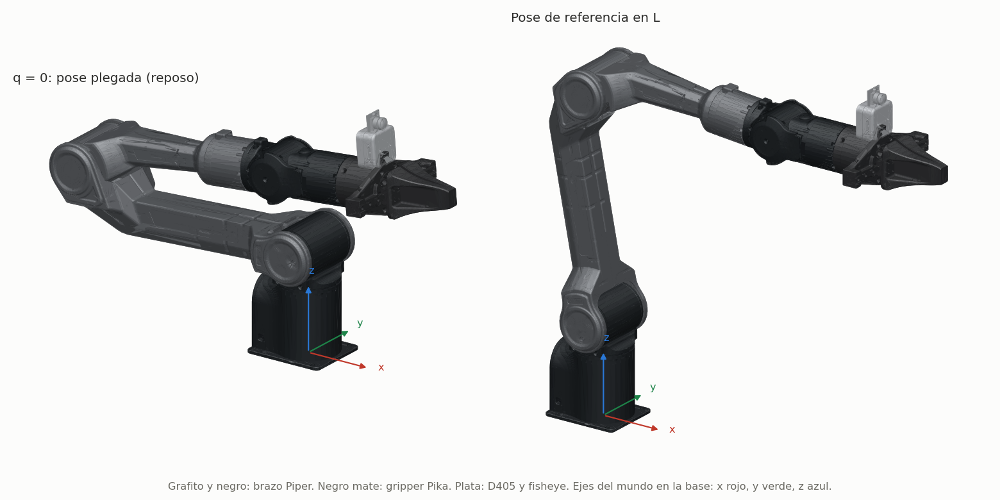
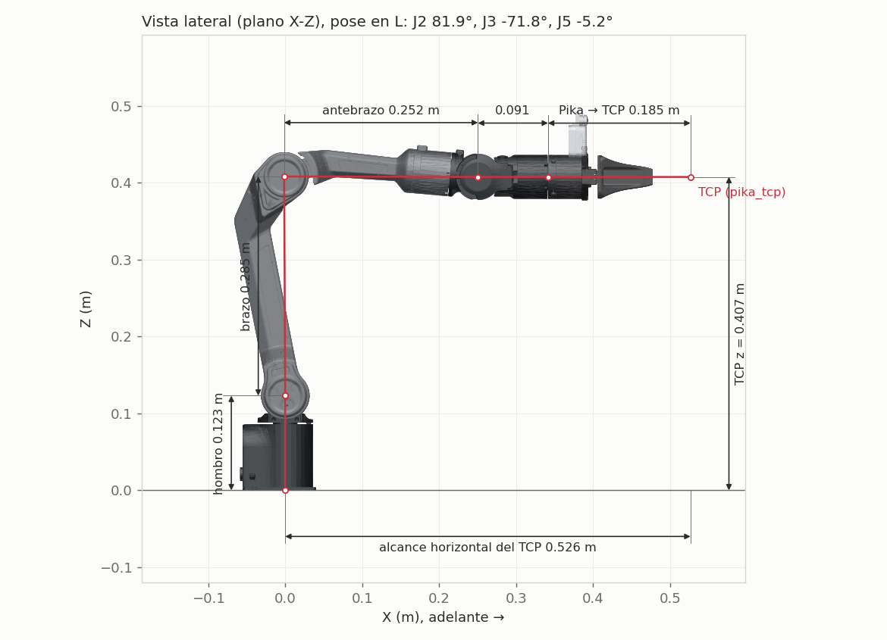
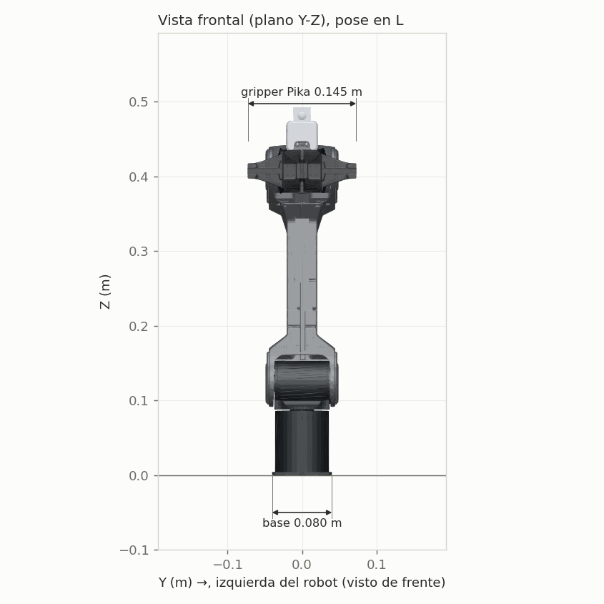
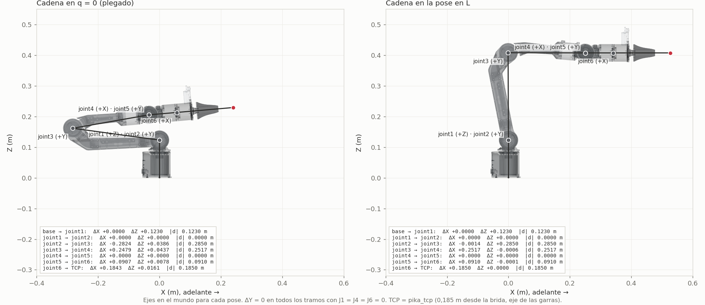
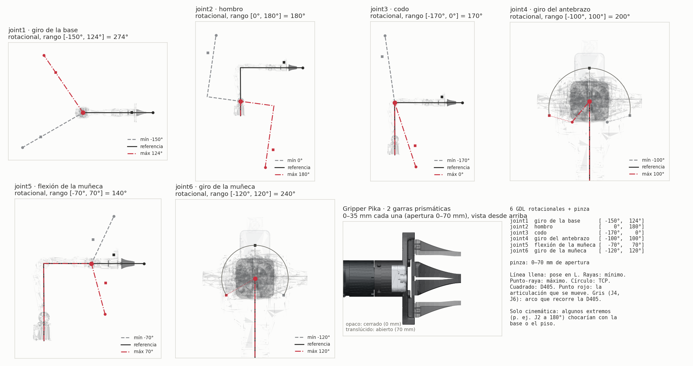
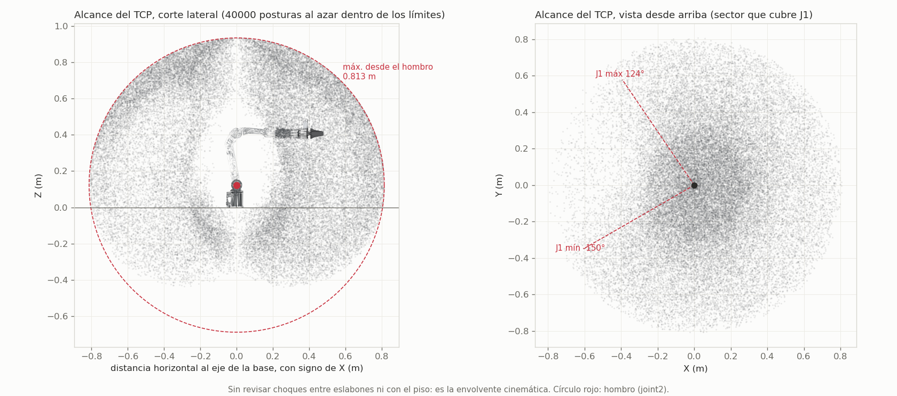

# Piper + gripper Pika: medidas y grados de libertad

Medidas, articulaciones y alcance del brazo AgileX Piper con el gripper Pika montado en la brida,
tal como los describe el modelo `pika_piper_standalone.urdf.xacro`. **Todo se calcula del URDF y
de las mallas**: las figuras y `figuras/medidas.json` se regeneran con

```bash
source ~/pika_ros/install/setup.bash        # sin conda
python3 ~/pika_ros/src/pika_description/scripts/figuras_piper_pika.py
```

Convenciones: REP-103 (+X adelante, +Y a la izquierda, +Z arriba), con el origen en la base del
brazo. El TCP es `pika_tcp`: 0,185 m desde la brida, sobre el eje de las garras.

## 1. Resumen

| Tramo | Largo | Qué es |
|---|---|---|
| base → hombro (J1/J2) | 0,123 m | altura del hombro sobre la base; J1 y J2 comparten origen |
| hombro → codo (J2 → J3) | 0,285 m | brazo |
| codo → muñeca (J3 → J4/J5) | 0,252 m | antebrazo; J4 y J5 comparten origen |
| muñeca → brida (J5 → J6) | 0,091 m | |
| brida → TCP | 0,185 m | gripper Pika hasta `pika_tcp` |
| **alcance máximo del TCP desde el hombro** | **0,813 m** | suma de los cuatro tramos anteriores |

| | |
|---|---|
| Grados de libertad | 6 rotacionales (brazo) + 1 de pinza (2 garras prismáticas en espejo) |
| TCP en la pose de referencia en L | (0,526; 0; 0,407) m |
| Envolvente del TCP (sin choques) | z de −0,44 a 0,94 m; hasta 0,81 m horizontal desde el eje de la base |
| Ancho | base 0,080 m; gripper Pika 0,145 m |

## 2. Dos poses de referencia



- **`q = 0` es la pose plegada.** J2 y J3 están en un tope (J2 ∈ [0°, 180°], J3 ∈ [−170°, 0°]): el brazo superior apunta hacia atrás y el antebrazo vuelve hacia adelante. Es la pose de reposo del robot real y donde cae el brazo sin compensación de gravedad en modo MIT.
- **Pose en L** (J2 = 81,9°, J3 = −71,8°, J5 = −5,2°, el resto en 0): brazo vertical, antebrazo y herramienta horizontales hacia +X. Se buscó numéricamente sobre el URDF porque ahí cada tramo se lee directo en las cotas.

## 3. Medidas





La cadena con el desplazamiento entre articulaciones, en las dos poses:



Dos detalles de la geometría:
- **J2 no está alineado con el brazo.** El URDF lo monta con un desfase de −0,1359 rad (−7,8°) y J3 con −1,7939 rad: el brazo superior del Piper es curvo, por eso la pose en L no es J2 = 90°, J3 = −90°.
- **Ejes que se cortan:** J1/J2 (hombro) y J4/J5 (muñeca) comparten origen.
- **La muñeca es esférica en la práctica.** Los ejes de J4, J5 y J6 se cortan en un punto, el centro de la muñeca: en 200 posturas al azar, los ejes de J4 y J6 pasan a menos de 0,09 mm de él. Con eso, la posición de la muñeca depende solo de J1–J3 y la orientación de la herramienta solo de J4–J6 (desacople de Pieper), así que una IK analítica es posible. La de la teleop es numérica por elección, no por necesidad.
- **Singularidad de muñeca con J5 = 0.** J4 y J6 quedan alineados, y el ángulo entre sus ejes es igual a |J5| (5,2° en la pose en L). Cerca de J5 = 0, girar J4 y J6 en sentidos opuestos no mueve la herramienta, y una IK puede dar saltos grandes en esas dos articulaciones. Para las vistas del NBV conviene evitar |J5| < ~10°.

## 4. Grados de libertad



Cada panel mueve una sola articulación desde la pose en L hasta su mínimo y su máximo. Los ejes
indicados son los de la pose en L.

| Articulación | Función | Eje (pose en L) | Rango | Recorrido |
|---|---|---|---|---|
| joint1 | giro de la base | +Z | −150° … +124° | 274° |
| joint2 | hombro | +Y | 0° … +180° | 180° |
| joint3 | codo | +Y | −170° … 0° | 170° |
| joint4 | giro del antebrazo | +X | −100° … +100° | 200° |
| joint5 | flexión de la muñeca | +Y | −70° … +70° | 140° |
| joint6 | giro de la muñeca | +X | −120° … +120° | 240° |
| pinza | 2 garras prismáticas en espejo | — | 0 … 35 mm cada una | apertura 0–70 mm |

- **Rango asimétrico de J1:** es −150° … +124°, no ±150°. El brazo gira más hacia la derecha (−Y) que hacia la izquierda.
- **J4 y J6 giran la cámara alrededor del eje de la herramienta:** la D405 recorre los arcos grises de sus paneles. Para la percepción activa, J6 cambia la orientación de la imagen sin mover el TCP.
- **Esfuerzo y velocidad:** el URDF trae `effort = 100` y `velocity = 5` en todas las articulaciones. Son valores de relleno del modelo, **no especificaciones del Piper**; no usarlos para dimensionar.

## 5. Alcance



Posiciones del TCP para 40 000 posturas al azar dentro de los límites articulares. **No revisa
choques** entre eslabones, con la base ni con el piso, así que una parte de la nube (debajo de
z = 0, o atravesando la base) no es alcanzable en la práctica. Sirve como cota superior. Para la
percepción activa, las vistas candidatas a 0,15–0,35 m de una fruta tienen que caer dentro de
esta envolvente **más** el radio de la vista.

## 6. Observaciones para el robot real

1. **El TCP queda ~5 cm más allá de las garras dibujadas.** `pika_tcp` está a 0,185 m de la brida, pero la punta de las garras de la malla queda a ~0,134 m. La malla del cuerpo es la del gripper original del Piper, no la de la carcasa Pika (215 × 191 × 143 mm, pendiente en el [README](../README.md)). Hay que **medir en el gripper real** dónde cierran las garras y corregir `pika_tcp`.
2. **La IK de la teleop usa otro TCP:** su frame `ee` está a 0,19 m de la brida, 5 mm más allá que `pika_tcp`. Conviene que ambos salgan del mismo valor medido.
3. **Masas:** las inercias del gripper Pika en el URDF son aproximadas. Afectan la compensación de gravedad del modo MIT (`scripts/calcular_gravedad_mit.py`).
