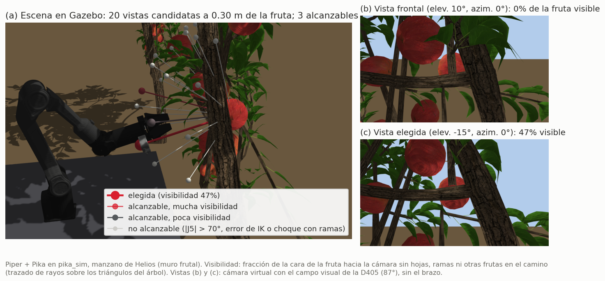
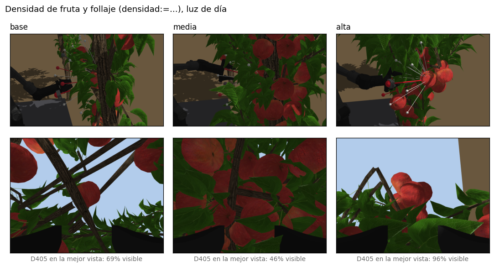
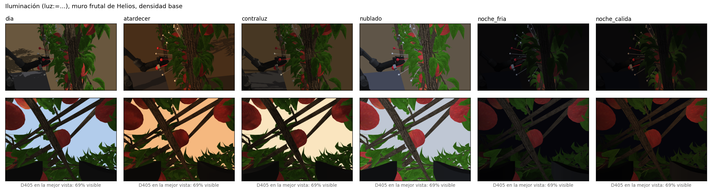

# pika_sim

Simulación Gazebo (Classic 11) del brazo Piper con el gripper Pika, para usar la
cadena de teleoperación de `pika_remote_piper` sin el robot físico.

El paquete reemplaza dos piezas de hardware y deja el resto igual:

| Hardware | Sustituto | Topics |
|---|---|---|
| Piper + driver CAN (`piper_single_ctrl`) | `piper_sim_bridge.py` + Gazebo | entra `/joint_states_gripper`, sale `/joint_states_single` (mismo formato que el driver) |
| Pika Sense + tracker Vive (opcional) | `fake_pika_sense.py` + marcador en RViz | sale `/pika_pose`; mezcla `/joint_states` → `/joint_states_gripper`; llama `/teleop_trigger` |

`piper_FK.py`, `piper_IK.py` y `teleop_piper_publish.py` corren sin cambios.

## Uso

**Terminal 1** — simulación (sin conda):
```bash
conda deactivate
source ~/pika_ros/install/setup.bash
ros2 launch pika_sim sim_piper_single.launch.py
```

**Terminal 2** — teleop, igual que en el Flujo A pero con `sim:=true` (no arranca el driver CAN):
```bash
source ~/pika_ros/install/setup.bash
conda activate pika
ros2 launch pika_remote_piper teleop_rand_single_piper.launch.py sim:=true
```

En RViz, **click derecho sobre el Pika Sense naranja** (simulado, con la malla de AgileX):
- *Teleop: iniciar / detener* — equivale al doble click del Sense
- *Pinza: abrir / media / cerrar*

Con la teleop iniciada, arrastra las flechas/anillos del marcador: el brazo sigue
el movimiento relativo, aplicado en el marco de la herramienta (igual que con el Vive).

### Con los dos Sense conectados

Con el montaje doble (`start_multi_sensor.bash`), los topics de cada Sense llevan sufijo `_l` o
`_r`. Para que el Piper simulado siga a uno de ellos, sin tocar las reglas udev (no usar
`start_single_sensor.bash`, que las reescribe por fabricante y deja ambiguos los dos Sense):

```bash
bash ~/pika_ros/scripts/start_multi_sensor.bash                                          # terminal 1, sin conda
ros2 launch pika_sim sim_piper_single.launch.py sense:=real lado:=_l                      # terminal 2, sin conda
ros2 launch pika_remote_piper teleop_rand_single_piper.launch.py sim:=true index_name:=_l # terminal 3, conda pika
```

Doble click en el Sense izquierdo arma la teleoperación (o `ros2 service call /teleop_trigger_l
std_srvs/srv/Trigger`). Cadena: `/pika_pose_l` → teleop → `/joint_states_l` → el nodo del Sense le
agrega la apertura de su pinza → `/joint_states_gripper_l` → puente → Gazebo → `/joint_states_single_l`
→ FK. Probado el 21-10-2026 con los dos Sense reales: Gazebo sigue al comando con menos de 0,002 rad
de diferencia y la pinza simulada copia la apertura del Sense (hasta 94 mm).

### Modo MIT (impedancia)

`control:=mit` emula el modo MIT del Piper con los valores de
`scripts/test_piper_mit_impedance.py` (`KP`, `KD`, `TARGETS`, `T_FF`, `ESCALA_GRAVEDAD`). Así se
prueban ganancias y compensación de gravedad sin el brazo. No usa la teleop.

```bash
ros2 launch pika_sim sim_piper_single.launch.py control:=mit [escala_gravedad:=0] [mit_script:=<ruta>]
ros2 topic pub --once /mit_emulador/perturbacion std_msgs/msg/Float64MultiArray "{data: [0, 1.0, 0, 0, 0, 0]}"
```

- **`kp·(q_d − q) + kd·(0 − q̇)`:** lo aplica Gazebo como resorte + amortiguador **implícitos** en cada articulación (`springStiffness`, `springReference`, `damping`). Un PD calculado desde un nodo ROS a 200 Hz sería inestable con las inercias mínimas de la muñeca.
- **`t_ref`** (y la perturbación): los manda `mit_emulador.py` como esfuerzo por `mit_ff_controller`.
- **Validación:** cada pieza se probó por separado (sin gravedad, el resorte llega a `q_d`; el esfuerzo desvía exactamente `τ/kp`). El conjunto coincide con el cálculo de pinocchio: sin compensación cae a la pose plegada; con `KP` J2 = 20, J3 = 15 sostiene la pose y cede [4,0°, 0,7°] por 1 N·m en J2.

### Argumentos

| Argumento | Default | Efecto |
|---|---|---|
| `control` | `teleop` | `mit`: emulación del modo MIT, sin puente ni Sense falso |
| `sense` | `fake` | `real`: no arranca el Sense falso; correr aparte `bash scripts/start_single_sensor.bash` con el Sense y las base stations conectados |
| `lado` | `''` | `_l` o `_r`: con `sense:=real` y los dos Sense conectados, el brazo simulado sigue a ese Sense (ver *Con los dos Sense conectados*) |
| `escena` | `ninguna` | `manzano`: carga el manzano de percepción activa (ver más abajo) |
| `semilla` | `7` | semilla del follaje del manzano; 7 es la de la documentación |
| `arbol` | `primitivas` | `helios`: manzano realista generado con Helios (ver más abajo) |
| `densidad` | `base` | con `arbol:=helios`: `media` o `alta`, más fruta en racimos y más follaje (hay que generarlos antes) |
| `ruta_helios` | (según `densidad`) | carpeta de otro árbol de Helios; pisa a `densidad` |
| `luz` | `dia` | iluminación: `dia`, `atardecer`, `contraluz`, `nublado`, `noche_fria`, `noche_calida` (ver más abajo) |
| `fondo` | `natural` | para renders: `blanco` o `croma` (magenta `#FF00FF`), sin suelo ni sombras; la plataforma queda |
| `camaras` | `true` | `false`: sin la D405 ni la fisheye del gripper (Gazebo más liviano, p. ej. en modo MIT) |
| `gui` | `true` | `false`: Gazebo sin ventana (solo `gzserver`) |
| `rviz` | `true` | `false`: sin RViz |

### Sin RViz (scripts / pruebas)

```bash
ros2 service call /teleop_trigger std_srvs/srv/Trigger
ros2 topic pub --once /fake_pika_sense/gripper_opening std_msgs/msg/Float64 "{data: 0.05}"
```

## Detalles

- **Modelo**: `urdf/pika_piper_gazebo.urdf.xacro` incluye `pika_description/pika_piper_standalone.urdf.xacro` y agrega `ros2_control`. Las mallas `package://` se convierten a `file://` en el launch, porque Gazebo Classic no las resuelve.
- **Control**: `JointGroupPositionController` (posición directa) para `joint1..6` y para las dos garras. `piper_IK.py` ya interpola, como con el robot real.
- **Estado de Gazebo**: sale por `/joint_state_broadcaster/joint_states` (`use_local_topics`), porque `/joint_states` es la salida de `piper_IK.py`. El puente lo reordena por nombre a `joint1..6`: Gazebo no lo publica en ese orden y FK/IK leen `position[:6]`.
- **Pinza**: `position[6]` es la apertura total en metros (0–0,07), igual que el driver real; cada garra recibe la mitad.
- **Reloj**: teleop, IK y el puente usan reloj de pared, como en el robot real; Gazebo y `robot_state_publisher` usan `use_sim_time`.

En modo MIT, el emulador reporta `q − q_d` en `/rosout` cada 2 s.

## Cámaras del gripper

La D405 y la fisheye del gripper Pika están simuladas con los topics del hardware real (los de
`single_pika_teleop_data_params.yaml` en `data_tools`), a 640 × 480 y 30 Hz:

| Topic | Contenido |
|---|---|
| `/gripper/camera/color/image_raw` y `camera_info` | D405 color, 87° de campo horizontal |
| `/gripper/camera/aligned_depth_to_color/image_raw` y `camera_info` | D405 profundidad en **16UC1 mm**, como el driver real; 0 fuera de 7–50 cm |
| `/gripper/camera/depth/color/points` | D405 nube de puntos, en `pika_d405_optical_frame` |
| `/gripper/camera_fisheye/color/image_raw` y `camera_info` | fisheye equidistante de 180° en horizontal (la real tiene 200° en diagonal) |

- **Profundidad:** Gazebo la publica en 32FC1 metros por `/gripper/camera/depth_sim/image_raw`, y `profundidad_mm.py` la convierte. Sin esa conversión, `dataCapture.cpp` guardaría 0 y 1, porque convierte con cv_bridge a 16UC1 sin reescalar.
- **Orientación y posición:** las del modelo de AgileX (`pika_description`): ambas cámaras miran a lo largo de +Z de `gripper_base`, el eje de la herramienta, y las garras quedan abajo en la imagen. La D405 tiene el centro óptico 4 mm detrás de la tapa; el sensor de Gazebo va 4 mm más adelante para dibujar desde fuera de la carcasa.
- **Verificado:** con el brazo en la mejor vista del manzano, miles de puntos de la nube caen a menos de 3 mm de la superficie de cada manzana y ninguno dentro, así que el marco óptico y el TF son correctos.
- Gazebo avisa `Error advertising topic [.../pika_fisheye/image]`. Es su transporte interno y no afecta a los topics de ROS.

## Escenario agrícola: manzano

```bash
ros2 launch pika_sim sim_piper_single.launch.py escena:=manzano [semilla:=7]
```

`escena_manzano.py` genera un manzano reproducible: la misma semilla da siempre el mismo árbol. Tiene
tronco, cinco ramas, follaje al azar a lo largo de las ramas y cuatro manzanas. La manzana objetivo
queda en (0,55; 0; 0,30) m, detrás de un racimo de hojas. Los objetos son solo visuales, sin
colisión, así que el brazo atraviesa las hojas.

El nodo spawnea el árbol y publica la verdad del terreno, con QoS *transient local* para que la
reciba quien se conecte después:

| Topic | Tipo | Contenido |
|---|---|---|
| `/escena/frutas` | `visualization_msgs/MarkerArray` | manzanas en el marco `world`; la objetivo en amarillo (RViz la muestra) |
| `/escena/verdad` | `std_msgs/String` (JSON) | semilla; manzanas (centro, radio, objetivo); hojas (centro, normal, radio); ramas |

Parámetros del nodo: `semilla` (7), `n_manzanas` (4, hasta 6), `densidad_hojas` (16 intentos por
rama) y `objetivo_ocluida` (`true`: racimo delante de la objetivo). El launch solo expone la
semilla; los demás se cambian corriendo el nodo aparte:

```bash
ros2 run pika_sim escena_manzano.py --ros-args -p semilla:=3 -p n_manzanas:=6 -p densidad_hojas:=24
```

### Manzano realista (Helios)



`arbol:=helios` reemplaza los discos y cilindros por un manzano completo de
[Helios](https://github.com/PlantSimulationLab/PyHelios) (UC Davis), un simulador de plantas
procedural. El árbol trae tronco, ramas con sus horquetas, pecíolos, hojas, pedúnculos y manzanas,
con texturas fotográficas de corteza, hoja y fruto. Por defecto se usa `apple_fruitingwall`, un muro
frutal en espaldera, que es el sistema de los huertos pensados para cosecha robótica.

**1. Generar el árbol una vez** (unos 20 s). PyHelios va en un entorno virtual aparte, sin ROS:

```bash
python3 -m venv ~/.venvs/helios && ~/.venvs/helios/bin/pip install pyhelios3d pillow
env -u PYTHONPATH ~/.venvs/helios/bin/python -I ~/pika_ros/src/pika_sim/scripts/generar_manzano_helios.py \
    [--modelo apple_fruitingwall|apple] [--edad 640] [--semilla 7] [--densidad base|media|alta]
```

**Densidad de fruta y follaje.** `--densidad` cambia parámetros de los brotes de Helios. Cada uno
se puede ajustar aparte (`--flor`, `--cuaja`, `--racimo`, `--brote`, `--hoja`):

| | `base` (Helios) | `media` | `alta` |
|---|---|---|---|
| Brotación floral (`flor`) | 0,3 | 0,5 | 0,7 |
| Cuaja de frutos (`cuaja`) | 0,3 | 0,45 | 0,6 |
| Manzanas por dardo (`racimo`) | 1 | 2 | 3 |
| Brotación vegetativa mínima (`brote`) | 0,1 | 0,25 | 0,4 |
| Tamaño de hoja (`hoja`) | 1,0 | 1,1 | 1,2 |
| **Resultado:** manzanas (raleadas) | 39 (0) | 197 (57) | 264 (714) |
| Hojas | 1318 | 2307 | 4366 |
| Triángulos dibujados por árbol (hojas con dos caras) | 235 000 | 434 000 | 791 000 |
| Tiempo de generación | 16 s | 32 s | 80 s |

Helios pone las manzanas de un mismo dardo casi en el mismo punto, y con mucha fruta se
interpenetran: hasta con la densidad base hay 3 pares. El generador las separa como esferas que se
empujan, sin moverlas más de 6 cm, y les agrega un pedúnculo hasta la rama. Las que igual no caben
se ralean, como en un huerto real. Por eso `alta` termina con 264 manzanas de las 978 que forma
Helios: el muro ya no tiene espacio para más.



Con `densidad:=media` o `alta` en el launch se carga el árbol correspondiente; hay que generarlo
antes con la misma `--densidad`.

El script escribe en `~/.cache/pika_sim/manzanos/<modelo>_e<edad>_s<semilla>/`:
- las mallas `madera.obj`, `hojas.obj` y `frutas.obj`, con sus texturas;
- `verdad.json`, con el centro y el radio de cada manzana;
- `triangulos.npz`, con los triángulos de hojas y madera para la visibilidad, y solo los de tronco y ramas para los choques.

Cada hoja se recorta a la silueta de la foto de hoja de manzano. Helios la dibuja como un
rectángulo curvo con transparencia, y la cámara de profundidad de Gazebo no respeta la
transparencia: vería rectángulos. La misma semilla da el mismo árbol. La edad fija la fenología:
hacia los 450 días el árbol está en reposo invernal, sin hojas.

**2. Lanzar:**

```bash
ros2 launch pika_sim sim_piper_single.launch.py escena:=manzano arbol:=helios
```

El nodo elige como objetivo la manzana cuya vista de frente se acerque más a 30 % de visibilidad
(parámetro `visibilidad_frontal`). Ubica el árbol para que esa manzana quede en (0,55; 0; 0,30) m.
Las manzanas candidatas son las que dejan la plataforma entre 0,4 y 1,4 m de altura.
- **Plataforma:** el robot queda sobre una plataforma. El suelo de Gazebo se reemplaza por uno de huerto a la altura que resulta, 0,76 m con el árbol por defecto.
- **Hilera:** se agrega un árbol vecino a cada lado (parámetro `vecinos`).
- **Verdad del terreno:** `/escena/verdad` trae las manzanas en `world`, la ruta de `triangulos.npz` y la transformación del árbol a `world`.

Con 117 manzanas y unos 235 000 triángulos dibujados por árbol, Gazebo sigue en tiempo real (factor 1,0) y
las cámaras del gripper a 30 Hz.

### Iluminación

`luz:=...` arma el mundo de Gazebo con el ambiente, el color de fondo y el sol de cada caso. Las
condiciones de luz cambian lo que ve la cámara, así que sirven para probar la percepción:

| `luz` | Sol | Ambiente | Para qué |
|---|---|---|---|
| `dia` (por defecto) | blanco, alto, con sombras | neutro | referencia, igual al mundo vacío de Gazebo |
| `atardecer` | cálido (~3000 K), bajo y de frente al árbol | cálido | hora dorada: sombras largas y color anaranjado |
| `contraluz` | cálido, detrás del árbol | tenue | caso difícil: la cara que ve el robot queda en sombra |
| `nublado` | frío (~7000 K) y difuso, sin sombras | frío y alto | día nublado |
| `noche_fria` | casi nulo | oscuro | cosecha nocturna con tres focos LED fríos (~6500 K) en la plataforma |
| `noche_calida` | casi nulo | oscuro | lo mismo con LED cálidos (~3000 K) |



Los focos de noche van en la plataforma, a los lados y sobre el brazo, apuntando a la manzana
objetivo. El mundo se escribe en `~/.cache/pika_sim/mundos/`. La luz no cambia la visibilidad
geométrica que calcula la demo (69 % en la mejor vista, con las seis): cambia la imagen, que es lo que tendría que
resolver un detector como YOLO.

**Licencias:** PyHelios es MIT, y el núcleo de Helios y sus texturas son LGPL-2.1. Por eso el repo
guarda el generador y no las mallas: cada máquina las genera.

## Renders para figuras

`render_camara.py` saca una imagen de alta resolución con una cámara virtual de Gazebo, sin
depender del tamaño de la ventana de `gzclient`. Cada render queda anotado en un `camaras.json`
junto a la imagen (posición, punto mirado, campo visual, resolución, pose del brazo y escena), para
repetirlo si cambia la escena:

```bash
ros2 launch pika_sim sim_piper_single.launch.py gui:=false rviz:=false escena:=manzano arbol:=helios fondo:=blanco
ros2 run pika_sim escena_nbv_demo.py --salida /tmp/demo --vistas_res 1280x960     # brazo en la mejor vista y marcadores
ros2 run pika_sim render_camara.py --salida G1.png --pos -0.68 0.78 0.85 --mira 0.33 0 0.24 --hfov 0.95 --res 3000x2000
```

- `--q` y `--pinza` mueven el brazo antes de la foto; `--fruta x y z r` pone una esfera ámbar como fruta.
- Con `--hfov` chico y la cámara lejos, la vista se acerca a una ortográfica (siluetas).
- `galeria_oclusion.py capturar --res 1280x960 --prefijo G3 --sufijo dia` guarda, por franja, la foto, la foto con la esfera magenta, la máscara binaria y un JSON con la visibilidad.
- La demo guarda además la profundidad de la D405 en crudo (`_d405_profundidad_16bit.png`, mm).

## Consumo de recursos

Medido el 20-10-2026 en este equipo: AMD Ryzen 7 5800H (8 núcleos, 16 hilos), 15 GB de RAM y
GPU NVIDIA RTX 3070 Laptop de 8 GB, que también dibuja el escritorio. Cada configuración se dejó
asentar 15 s y se midió durante 30 s. Se midió por grupo de procesos, leyendo `/proc`, y se usaron
`nvidia-smi` y `gz stats`. La CPU va en % de un núcleo: 100 % es un núcleo entero de los 16 hilos.

| Configuración | CPU simulación | `gzserver` | `gzclient` + `rviz2` | RAM | GPU (uso / memoria) | Tiempo real | Cámaras |
|---|---|---|---|---|---|---|---|
| Sin escena, sin ventanas | 137 % | 109 % | — | 0,7 GB | 34 % / 670 MB | 1,00 | 30 / 30 Hz |
| Manzano de primitivas | 143 % | 115 % | — | 1,0 GB | 34 % / 655 MB | 0,96 | 29 / 30 Hz |
| Helios base | 126 % | 97 % | — | 0,9 GB | 39 % / 662 MB | 1,00 | 30 / 30 Hz |
| Helios base, `camaras:=false` (\*) | **39 %** | 21 % | — | 0,6 GB | **0 %** / 496 MB | 1,00 | — |
| Helios media (\*) | 131 % | 104 % | — | 0,9 GB | 39 % / 676 MB | 1,00 | 30 / 28 Hz |
| Helios alta | 131 % | 103 % | — | 1,1 GB | 40 % / 702 MB | 1,00 | 30 / 30 Hz |
| Helios base, `luz:=noche_fria` (\*) | 120 % | 93 % | — | 0,9 GB | 30 % / 600 MB | 1,00 | 30 / 30 Hz |
| Helios base, con Gazebo y RViz | 250 % | 106 % | 27 % + 78 % | 1,7 GB | 50 % / 961 MB | 0,98 | 30 / 30 Hz |
| Helios alta, con Gazebo y RViz (2 corridas) | **263–270 %** | 121–122 % | 27 % + 80–85 % | 2,0–2,2 GB | **76–78 %** / 1036 MB | 1,00 | **24 / 17–23 Hz** |

La GPU incluye el escritorio, que en reposo usa 5–6 % y ~510 MB. La columna Cámaras es D405 color /
fisheye. Las filas con (\*) se midieron antes de escribir las hojas con sus dos caras, que duplicó
los triángulos de hoja; en las filas que se repitieron, sin ventanas, el cambio fue menor a 2 %.

**Lo que dicen los números:**
- **El caso más pesado ocupa menos de un quinto del CPU y la RAM:** 2,7 núcleos de 16 y 2,2 GB de 15. La GPU llega a 78 %. La física va siempre en tiempo real.
- **Lo que cuesta son las cámaras del gripper, no el árbol.** Sin cámaras, `gzserver` baja de un núcleo a 0,2 y la GPU queda libre. No se midieron por separado, pero Gazebo dibuja la fisheye como un cubo de 6 imágenes a 30 Hz, así que es la candidata a bajar primero (resolución o frecuencia) si hace falta liberar GPU.
- **Sin ventanas, la densidad casi no cambia el consumo:** de la densidad base a la alta, la CPU sube 4 % y la GPU 1 punto, porque la geometría es estática y la dibuja la GPU. **Con ventanas sí pesa:** `gzclient` dibuja la hilera completa y la GPU sube de 50 % a 78 %.
- **Con ventanas, RViz gasta más que Gazebo:** 0,7–0,9 núcleos, sobre todo por la nube de la D405, de 307 000 puntos a 30 Hz. Si no se necesita, conviene desactivar el display de la nube.
- **Para grabar, sin ventanas:** con densidad alta, Gazebo y RViz, las cámaras bajan a 24 Hz (D405) y 17–23 Hz (fisheye), **bajo los 25 Hz que exige `data_tools`**. Sin ventanas, o con la densidad base, siguen a 30 Hz.
- **El modo `noche` es algo más liviano:** sin sombras del sol, la GPU baja a 30 %.

## Escena de demostración de NBV

Con la simulación en modo teleop corriendo (`gui:=false rviz:=false` sirve), el script hace lo siguiente:

```bash
ros2 launch pika_sim sim_piper_single.launch.py gui:=false rviz:=false escena:=manzano
ros2 run pika_sim escena_nbv_demo.py --salida ~/pika_ros/docs/percepcion_activa/img
python3 ~/pika_ros/src/pika_sim/scripts/panel_nbv.py ~/pika_ros/docs/percepcion_activa/img nbv_manzano
```

1. Arma una escena:
   - `manzano` (por defecto): si la simulación se lanzó con `escena:=manzano`, usa ese árbol (lo lee de `/escena/verdad`); si no, lo genera y spawnea con `--semilla`;
   - `prueba`: una fruta y tres hojas.
2. Genera 20 vistas candidatas en un casquete y calcula la visibilidad de cada una y si es alcanzable (IK para la D405, con |J5| > 10°). La visibilidad es la fracción del área de la fruta en la imagen sin nada delante: rayos desde puntos repartidos sobre el disco de la fruta hasta la cámara, contra las hojas y las otras frutas. Coincide con la imagen de Gazebo en ±4,5 puntos (`galeria_oclusion.py`, ver el [informe de escenarios](../../docs/percepcion_activa/escenarios_simulacion.md#4-oclusión-manzanas-con-distinto-nivel-de-visibilidad)).
   - Con el manzano de Helios, los rayos se trazan contra los triángulos reales de hojas y madera.
   - Además, se descartan las vistas en que la cámara o las puntas de las garras, unos 15 cm por delante de la D405, pasarían a menos de 3 cm de tronco o ramas (`--despeje`). Pecíolos y pedúnculos no cuentan, porque ceden.
   - El casquete es de 0,22 m con primitivas y de 0,30 m con Helios (`--radio`). Con 0,22 m, las garras quedan a unos 3 cm de la piel de la manzana, entre las ramas: en la primera prueba con el árbol de Helios, 18 de las 20 vistas chocaban.
3. Lleva el brazo a la mejor vista.
4. Guarda lo que ven la D405 (`_d405_color.png`, `_d405_profundidad.png`) y la fisheye (`_fisheye.png`) del gripper en esa vista.
5. Guarda capturas de cámaras virtuales: la escena, la vista frontal y la elegida, más un JSON con los números.

`panel_nbv.py` arma con todo eso la figura `<prefijo>_escena_panel.png`. El prefijo es `nbv_manzano`, `nbv_helios` (árbol de Helios) o, para la escena de prueba, `nbv`.
La demo se puede repetir sobre la misma simulación: borra sus marcadores y cámaras auxiliares.

Las cámaras de Gazebo necesitan `DISPLAY`: en una sesión sin pantalla, usar un servidor X virtual. Es
una demostración para documentación, no el planner del paso 4. Los colores AgileX del brazo en
Gazebo se definen en `urdf/pika_piper_gazebo.urdf.xacro` (Gazebo Classic no usa los materiales
del URDF).

## Pendiente

- Probar una captura completa con `data_tools`: el config `single_pika_teleop` pide además topics del Sense y del brazo.
- Niveles de oclusión controlados (25–100 %): con Helios, elegir la manzana objetivo por nivel de visibilidad y variar la edad y la semilla ([recursos públicos](../../docs/percepcion_activa/recursos_publicos.md)).
- Choques del brazo completo con las ramas: la demo solo revisa la cámara y las garras. Hace falta MoveIt (paso 2 de la hoja de ruta).
- Árbol libre (`--modelo apple`): parte de la copa (~2 % de los triángulos) cae sobre la plataforma y el brazo la atraviesa. Habría que podar en el generador lo que quede del lado del robot; el muro frutal no tiene el problema.
- Versión para dos brazos (`teleop_rand_multi_piper.launch.py`).
